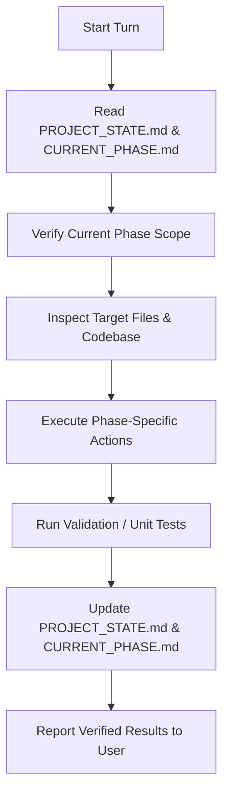

# AGENTS.md — Permanent Guidelines for AI Coding Agents

**Project Name:** PhishVision AI (Phishing Website and Brand Impersonation Detector)  
**Repository:** `c:\Users\hp\PycharmProjects\pbl_dl`  
**Active Python Environment:** `C:\Users\hp\PycharmProjects\blansole_footscan\.venv` (Python 3.13.3 with CUDA 12.4 PyTorch, Torchvision, Ultralytics YOLO, scikit-learn, FastAPI)

---

## 1. Core Operating Principles

Every AI assistant or agent working on PhishVision AI must strictly adhere to these immutable rules:

1. **Read Project Documentation First:**  
   Before executing any instruction or proposing edits, always inspect `PROJECT_STATE.md`, `CURRENT_PHASE.md`, `ARCHITECTURE.md`, `REQUIREMENTS.md`, and `API_CONTRACTS.md`. Never make assumptions about existing code or architecture without checking.

2. **Inspect Existing Files Before Editing:**  
   Always check directory contents and read relevant source files prior to modifying or appending code. Never perform blind overwrites.

3. **Work Only on the Requested Phase:**  
   Strictly confine work to the phase specified by the user or defined in `CURRENT_PHASE.md`. Do not implement, scaffold, or jump ahead to future phases prematurely.

4. **Do Not Rewrite Working Code:**  
   Refactoring must be minimal, purposeful, and backwards-compatible. Never replace established, tested modules with arbitrary new abstractions unless specifically directed.

5. **Preserve API Contracts:**  
   All interfaces, schemas, and endpoint definitions detailed in `API_CONTRACTS.md` are binding. Any breaking change requires explicit documentation in `DECISIONS.md` and synchronization across both backend and frontend specifications.

6. **Reproducibility & Integrity:**  
   - All dataset preprocessing and model training must enforce fixed random seeds (`torch.manual_seed(42)`, `numpy.random.seed(42)`).
   - **Never fabricate data, mock scores, or synthetic benchmark metrics.** Only report actual, empirically measured numbers from running code.

7. **Record Changes & Document Progress:**  
   - After completing each task or milestone, immediately update `PROJECT_STATE.md` and `CURRENT_PHASE.md`.
   - Maintain an accurate, up-to-date registry of known issues, pending tasks, and validated tests.

8. **Never Claim Completion Before Verification:**  
   Do not state that a phase, feature, or bugfix is complete until actual unit tests, type checks, or validation commands have been executed and passed.

9. **Respect the Pre-Configured Virtual Environment:**  
   The project uses the existing virtual environment at:  
   `C:\Users\hp\PycharmProjects\blansole_footscan\.venv`  
   Do not run global `pip install` or create duplicate local venvs unless specifically instructed. To run Python scripts, use:  
   `& "C:\Users\hp\PycharmProjects\blansole_footscan\.venv\Scripts\python.exe"`  
   *(Note: Since this path resides outside the repository workspace, terminal tool calls accessing this executable require `BypassSandbox: true` if sandboxed access is blocked).*

10. **Strict Technology Stack & Language Mandate:**  
    - **Python is the exclusive language for backend, machine learning, mathematical implementations, training, inference, experiments, and automated tests. React/JavaScript is permitted for the frontend. Never introduce C, C++, or Java implementations, build systems, or dependencies.**
    - **GANs are strictly forbidden.** Generative experiments must use Variational Autoencoders (VAE) only.
    - Production inference must remain distinct and decoupled from offline/academic experimental pipelines.
    - Security-first scanning: Anti-SSRF, DNS resolution pinning, private IP blocks (RFC 1918 / RFC 4193 / link-local / loopback), and resource timeouts are mandatory for all dynamic fetching.

---

## 2. Standard Agent Workflow Per Task

---

## 3. Communication and Response Standards

- Keep responses clear, professional, and grounded in actual filesystem state.
- Provide clickable Markdown file links (e.g., `[ARCHITECTURE.md](ARCHITECTURE.md)`).
- Never claim that application features exist when only design documentation or scaffolding has been written.
- If a blocking issue or ambiguity arises, document it in `PROJECT_STATE.md` under "Known Issues" and seek clarification.

## Execution Efficiency Rules — Mandatory

The goal is to make meaningful implementation progress with minimal unnecessary overhead.

1. **Don't over-plan:** Once the task and requirements are clear, proceed with implementation. Do not repeatedly analyze, reconsider, or rewrite the same plan.

2. **Inspect only what matters:** Read the relevant project files and dependencies. Avoid repeatedly scanning the entire repository when the required context is already available.

3. **No unnecessary testing loops:**
   - Do not run the same test repeatedly if no relevant code has changed.
   - Do not create additional tests just to demonstrate activity.
   - Do not repeatedly test unrelated modules.
   - Run only the tests necessary to verify the current changes.

4. **Prioritize implementation:** Spend most of the execution effort building the requested functionality, not writing lengthy explanations, generating excessive reports, or performing unnecessary checks.

5. **Use existing work:** Reuse working code, dependencies, utilities, and existing architecture. Never rebuild something that already works without a concrete reason.

6. **Avoid unnecessary confirmations:** Make reasonable engineering decisions independently when requirements are clear. Ask questions only when a missing decision genuinely blocks implementation.

7. **Keep progress focused:** Work in small, complete implementation units. Avoid spending excessive time on minor optimizations, formatting, or speculative improvements.

8. **Verification policy:**
   - Run relevant unit tests and essential integration checks.
   - Fix actual failures caused by your changes.
   - Do not attempt to achieve 100% test coverage during every phase.
   - Do not claim something works unless it has actually been verified.
   - If a test requires unavailable infrastructure, document that limitation and continue with other work.

9. **No scope expansion:** Do not implement future-phase features, introduce unnecessary dependencies, or refactor unrelated code.

10. **Report concisely:** At the end, provide:
    - What was implemented
    - Files created or modified
    - Essential verification performed and results
    - Any genuine blockers
    - Exact next action

**Execution principle:** Be an implementation-focused engineering agent. Use judgment, avoid repetitive work, and make tangible progress. Correctness and security matter, but unnecessary process must not become a substitute for implementation.