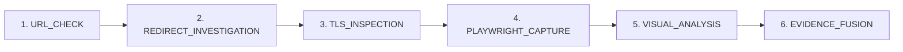

# API_CONTRACTS.md — REST API Contracts & Data Schemas

**Project:** PhishVision AI (Phishing Website and Brand Impersonation Detector)  
**Status:** Frozen & Fully Implemented (Phase 9)  
**Base URL:** `/api/v1`  
**Last Updated:** 2026-11-23  

---

## 1. RESTful Endpoints Overview

| Method | Endpoint | Description | Status Codes |
| :--- | :--- | :--- | :--- |
| `POST` | `/api/v1/scan` | Submits a target URL for automated six-stage scanning and risk analysis. | `202 Accepted`, `400 Bad Request` |
| `GET` | `/api/v1/scan/{scan_id}` | Polls the current real-time stage progress and status of an ongoing or completed scan. | `200 OK`, `404 Not Found` |
| `GET` | `/api/v1/scan/{scan_id}/report` | Retrieves the full, explainable forensic security report for a completed scan. | `200 OK`, `404 Not Found`, `425 Too Early`, `500 Internal Server Error` |
| `GET` | `/api/v1/scan/{scan_id}/screenshot` | Returns the captured PNG screenshot of the rendered webpage. | `200 OK`, `404 Not Found` |
| `POST` | `/api/v1/analyze/url` | Fast synchronous lexical and sequence URL intelligence (M-01 + M-07). | `200 OK`, `400 Bad Request` |
| `POST` | `/api/v1/analyze/brand-similarity` | Uploads an image for Siamese CNN brand comparison against reference gallery. | `200 OK`, `400 Bad Request`, `413 Payload Too Large`, `500 Internal Server Error`, `503 Service Unavailable` |
| `GET` | `/api/v1/brands` | Lists all 18 monitored reference brands, official domains, and authorized subdomains. | `200 OK` |
| `GET` | `/api/v1/health` | Comprehensive system health check, device information, and per-model checkpoint status. | `200 OK`, `503 Service Unavailable` |

---

## 1.1 Six-Stage Scan Pipeline Lifecycle

The asynchronous scan job executes the following six stages in deterministic sequence:



1. **`URL_CHECK`**: Anti-SSRF URL validation, DNS resolution pinning, and preliminary pre-browser lexical scoring (M-01 Lexical MLP + M-07 Sequence Bi-LSTM).
2. **`REDIRECT_INVESTIGATION`**: Multi-hop redirect tracking, cross-domain hop analysis, and suspicious redirect parameter detection (`url=`, `redirect=`, `goto=`).
3. **`TLS_INSPECTION`**: Cryptographic certificate inspection for HTTPS targets (issuer DN, SANs, validity dates, SHA-256 fingerprint, expired cert detection). Skipped for HTTP.
4. **`PLAYWRIGHT_CAPTURE`**: Headless browser rendering, full viewport screenshot capture, DOM password input extraction, and external form action parsing.
5. **`VISUAL_ANALYSIS`**: Global layout classification (M-02 ResNet-18), Siamese brand matching (M-03), and object detection & segmentation (M-04 YOLOv8n, M-05 Faster R-CNN, M-06 YOLOv8-Seg) with spatial consensus.
6. **`EVIDENCE_FUSION`**: Multi-signal risk fusion synthesizing URL, TLS, visual, and behavioral evidence into a calibrated risk score, threat category, and explainable forensic narrative.

---

## 2. Core Data Schemas (Pydantic / JSON Schema Equivalent)

### 2.1 Ingress Schemas

#### `ScanRequest`
```json
{
  "$schema": "http://json-schema.org/draft-07/schema#",
  "title": "ScanRequest",
  "type": "object",
  "required": ["url"],
  "properties": {
    "url": {
      "type": "string",
      "format": "uri",
      "description": "Full HTTP or HTTPS target URL to scan",
      "example": "https://sbi.co.in.attacker.com/login"
    },
    "options": {
      "type": "object",
      "properties": {
        "fast_mode": {
          "type": "boolean",
          "default": false,
          "description": "If true, skips dynamic browser rendering and runs lexical URL models only"
        },
        "viewport": {
          "type": "object",
          "properties": {
            "width": { "type": "integer", "default": 1280 },
            "height": { "type": "integer", "default": 720 }
          }
        },
        "timeout_seconds": {
          "type": "integer",
          "default": 15,
          "minimum": 3,
          "maximum": 30
        }
      }
    }
  }
}
```

---

### 2.2 Forensic Intelligence Schemas

#### `URLIntelligenceReport`
```json
{
  "type": "object",
  "required": ["raw_url", "canonical_url", "hostname", "registrable_domain", "subdomain", "tld"],
  "properties": {
    "raw_url": { "type": "string" },
    "canonical_url": { "type": "string" },
    "hostname": { "type": "string" },
    "registrable_domain": { "type": "string" },
    "subdomain": { "type": "string" },
    "tld": { "type": "string" },
    "is_ip_address": { "type": "boolean" },
    "has_punycode": { "type": "boolean" },
    "decoded_punycode": { "type": ["string", "null"] },
    "has_homoglyphs": { "type": "boolean" },
    "homoglyph_details": {
      "type": "array",
      "items": {
        "type": "object",
        "properties": {
          "char": { "type": "string" },
          "unicode_point": { "type": "string" },
          "resembles": { "type": "string" },
          "script": { "type": "string" }
        }
      }
    },
    "entropy": {
      "type": "object",
      "properties": {
        "url_entropy": { "type": "number" },
        "hostname_entropy": { "type": "number" },
        "path_entropy": { "type": "number" }
      }
    },
    "typosquatting": {
      "type": "object",
      "properties": {
        "target_brand": { "type": ["string", "null"] },
        "levenshtein_distance": { "type": ["integer", "null"] },
        "damerau_levenshtein_distance": { "type": ["integer", "null"] },
        "is_suspicious_match": { "type": "boolean" }
      }
    },
    "subdomain_masking_detected": { "type": "boolean" },
    "mlp_lexical_score": { "type": "number", "minimum": 0.0, "maximum": 1.0 }
  }
}
```

#### `VisualIntelligenceReport`
```json
{
  "type": "object",
  "required": ["screenshot_captured", "resnet_phishing_probability"],
  "properties": {
    "screenshot_captured": { "type": "boolean" },
    "screenshot_hash_phash": { "type": ["string", "null"] },
    "resnet_phishing_probability": { "type": "number", "minimum": 0.0, "maximum": 1.0 },
    "detections": {
      "type": "array",
      "items": {
        "type": "object",
        "properties": {
          "class_name": { "type": "string", "enum": ["logo", "login_field", "password_field", "submit_button", "qr_code"] },
          "confidence": { "type": "number" },
          "bbox": {
            "type": "object",
            "properties": {
              "x_min": { "type": "number" },
              "y_min": { "type": "number" },
              "x_max": { "type": "number" },
              "y_max": { "type": "number" }
            }
          }
        }
      }
    },
    "brand_similarity": {
      "type": "object",
      "properties": {
        "matched_brand": { "type": ["string", "null"] },
        "similarity_score": { "type": "number", "minimum": 0.0, "maximum": 1.0 },
        "reference_asset_id": { "type": ["string", "null"] },
        "is_unauthorized_brand_use": { "type": "boolean" }
      }
    },
    "segmentation_summary": {
      "type": "object",
      "properties": {
        "form_area_percentage": { "type": "number" },
        "header_area_percentage": { "type": "number" }
      }
    }
  }
}
```

#### `BehavioralReport`
```json
{
  "type": "object",
  "required": ["redirect_hops_count", "suspicious_form_actions"],
  "properties": {
    "redirect_hops_count": { "type": "integer" },
    "redirect_chain": {
      "type": "array",
      "items": {
        "type": "object",
        "properties": {
          "step": { "type": "integer" },
          "url": { "type": "string" },
          "status_code": { "type": "integer" },
          "domain": { "type": "string" }
        }
      }
    },
    "cross_domain_redirects": { "type": "boolean" },
    "lstm_sequence_score": { "type": ["number", "null"] },
    "transformer_sequence_score": { "type": ["number", "null"] },
    "forms": {
      "type": "array",
      "items": {
        "type": "object",
        "properties": {
          "form_id": { "type": "string" },
          "action_url": { "type": "string" },
          "action_registrable_domain": { "type": "string" },
          "is_external_submission": { "type": "boolean" },
          "has_password_field": { "type": "boolean" }
        }
      }
    },
    "external_script_domains": {
      "type": "array",
      "items": { "type": "string" }
    },
    "js_suspicious_patterns": {
      "type": "array",
      "items": { "type": "string" }
    }
  }
}
```

---

### 2.3 Master Assessment & Risk Fusion Schema

#### `ScanStatusResponse` (Polling `/api/v1/scan/{scan_id}`)
```json
{
  "type": "object",
  "required": ["scan_id", "status", "target_url", "timestamp", "poll_url"],
  "properties": {
    "scan_id": { "type": "string", "format": "uuid" },
    "status": { "type": "string", "enum": ["IN_PROGRESS", "COMPLETED", "FAILED", "BLOCKED_SSRF"] },
    "target_url": { "type": "string" },
    "timestamp": { "type": "string", "format": "date-time" },
    "current_stage": { "type": ["string", "null"], "enum": ["URL_CHECK", "REDIRECT_INVESTIGATION", "TLS_INSPECTION", "PLAYWRIGHT_CAPTURE", "VISUAL_ANALYSIS", "EVIDENCE_FUSION", null] },
    "progress_percent": { "type": "number", "minimum": 0.0, "maximum": 100.0 },
    "stages": {
      "type": "object",
      "description": "Map of stage name to ScanStageProgress object",
      "additionalProperties": {
        "type": "object",
        "properties": {
          "name": { "type": "string" },
          "status": { "type": "string", "enum": ["PENDING", "IN_PROGRESS", "COMPLETED", "FAILED", "SKIPPED", "UNAVAILABLE"] },
          "started_at": { "type": ["string", "null"] },
          "completed_at": { "type": ["string", "null"] },
          "duration_ms": { "type": ["number", "null"] },
          "message": { "type": "string" },
          "error": { "type": ["string", "null"] },
          "data": { "type": "object" }
        }
      }
    },
    "poll_url": { "type": "string" },
    "report_url": { "type": ["string", "null"] },
    "final_verdict": { "type": ["string", "null"] },
    "risk_score": { "type": ["number", "null"] }
  }
}
```

#### `TLSEvidenceReport`
```json
{
  "type": "object",
  "properties": {
    "tls_available": { "type": "boolean" },
    "certificate_valid": { "type": "boolean" },
    "issuer": { "type": ["string", "null"] },
    "subject": { "type": ["string", "null"] },
    "common_name": { "type": ["string", "null"] },
    "san": { "type": "array", "items": { "type": "string" } },
    "not_before": { "type": ["string", "null"] },
    "not_after": { "type": ["string", "null"] },
    "is_expired": { "type": "boolean" },
    "days_until_expiry": { "type": ["integer", "null"] },
    "sha256_fingerprint": { "type": ["string", "null"] },
    "protocol_version": { "type": ["string", "null"] },
    "cipher_suite": { "type": ["string", "null"] },
    "error": { "type": ["string", "null"] }
  }
}
```

#### `RedirectIntelligenceReport`
```json
{
  "type": "object",
  "properties": {
    "hop_count": { "type": "integer" },
    "unique_domains": { "type": "array", "items": { "type": "string" } },
    "cross_domain_hop_count": { "type": "integer" },
    "has_cross_domain_redirects": { "type": "boolean" },
    "suspicious_redirect_patterns": { "type": "array", "items": { "type": "string" } }
  }
}
```

#### `ScanReport` (Full Forensic Assessment `/api/v1/scan/{scan_id}/report`)
```json
{
  "type": "object",
  "required": ["scan_id", "status", "target_url", "timestamp", "risk_assessment"],
  "properties": {
    "scan_id": { "type": "string", "format": "uuid" },
    "status": { "type": "string", "enum": ["COMPLETED", "FAILED", "BLOCKED_SSRF"] },
    "target_url": { "type": "string" },
    "timestamp": { "type": "string", "format": "date-time" },
    "elapsed_seconds": { "type": "number" },
    "risk_assessment": {
      "type": "object",
      "required": ["category", "risk_score", "confidence", "summary"],
      "properties": {
        "category": {
          "type": "string",
          "enum": ["LEGITIMATE", "SUSPICIOUS", "PHISHING", "CRITICAL_PHISHING", "UNKNOWN / INSUFFICIENT EVIDENCE", "BLOCKED_SSRF"]
        },
        "risk_score": { "type": "number", "minimum": 0.0, "maximum": 1.0 },
        "confidence": { "type": "number", "minimum": 0.0, "maximum": 1.0 },
        "summary": { "type": "string" },
        "contributing_factors": {
          "type": "array",
          "items": {
            "type": "object",
            "properties": {
              "vector": { "type": "string" },
              "severity": { "type": "string", "enum": ["CRITICAL", "HIGH", "MEDIUM", "LOW", "INFO"] },
              "description": { "type": "string" },
              "evidence_ref": { "type": ["string", "null"] }
            }
          }
        }
      }
    },
    "url_intelligence": { "$ref": "#/properties/URLIntelligenceReport" },
    "visual_intelligence": { "$ref": "#/properties/VisualIntelligenceReport" },
    "behavioral_intelligence": { "$ref": "#/properties/BehavioralReport" },
    "preliminary_url_risk": {
      "type": ["object", "null"],
      "properties": {
        "m01_lexical_score": { "type": ["number", "null"] },
        "m01_above_threshold": { "type": ["boolean", "null"] },
        "m07_lstm_score": { "type": ["number", "null"] },
        "composite_url_risk": { "type": ["number", "null"] },
        "analysis_stage": { "type": "string" },
        "note": { "type": "string" }
      }
    },
    "tls_evidence": { "$ref": "#/properties/TLSEvidenceReport" },
    "redirect_intelligence": { "$ref": "#/properties/RedirectIntelligenceReport" },
    "model_availability": {
      "type": "array",
      "items": {
        "type": "object",
        "properties": {
          "model_id": { "type": "string" },
          "name": { "type": "string" },
          "status": { "type": "string", "enum": ["LOADED", "MISSING", "UNKNOWN"] }
        }
      }
    },
    "scan_stages": {
      "type": "object",
      "description": "Forensic audit trail of all execution stages, timings, and statuses"
    },
    "mitigating_evidence": {
      "type": "array",
      "items": { "type": "string" }
    },
    "unavailable_evidence": {
      "type": "array",
      "items": { "type": "string" }
    },
    "explanation": { "type": ["string", "null"] },
    "disclaimer": { "type": ["string", "null"] }
  }
}
```

---

## 3. Standard Error Contract

All error responses adhere strictly to the RFC 7807 Problem Details specification:

```json
{
  "type": "object",
  "required": ["error_code", "message", "timestamp"],
  "properties": {
    "error_code": {
      "type": "string",
      "enum": [
        "INVALID_URL_SCHEME",
        "SSRF_ATTEMPT_BLOCKED",
        "DNS_RESOLUTION_FAILED",
        "BROWSER_TIMEOUT",
        "RATE_LIMIT_EXCEEDED",
        "INTERNAL_INFERENCE_ERROR",
        "RESOURCE_NOT_FOUND"
      ]
    },
    "message": { "type": "string" },
    "detail": { "type": ["string", "object", "null"] },
    "timestamp": { "type": "string", "format": "date-time" }
  }
}
```
