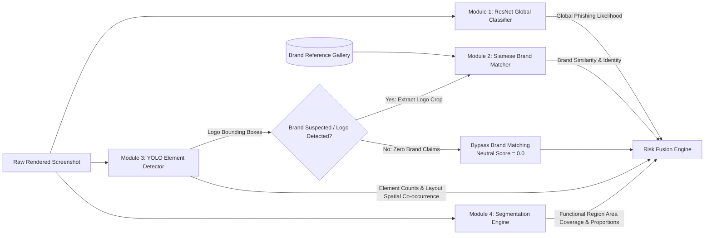
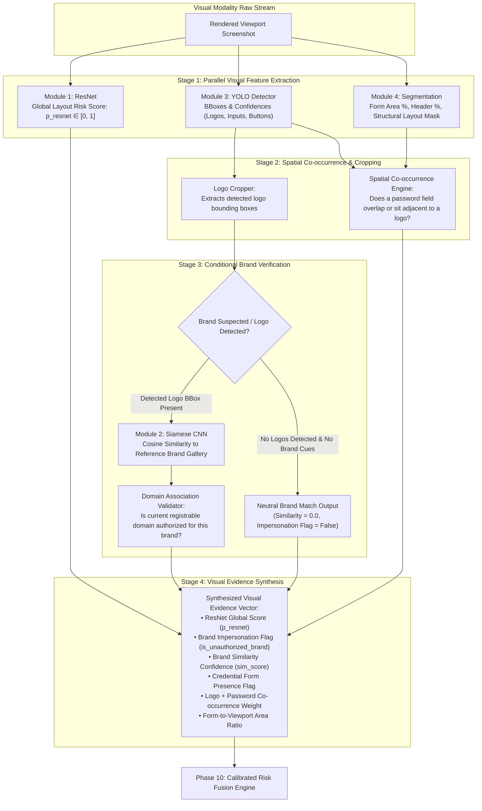
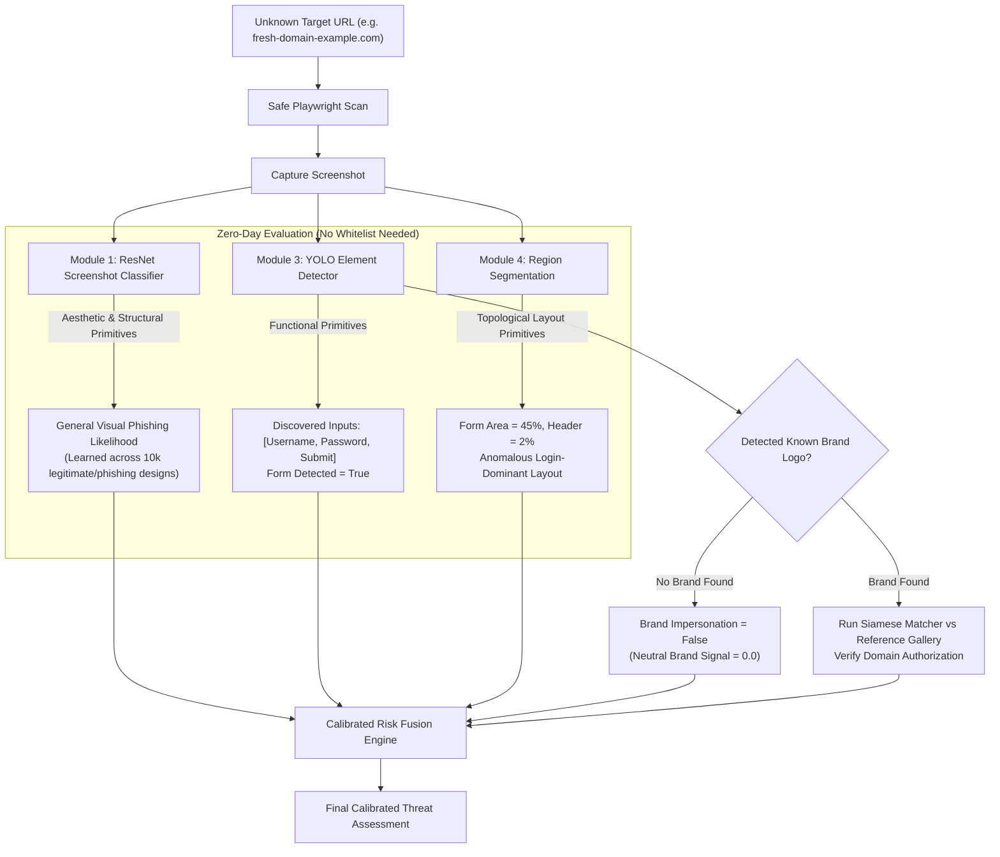
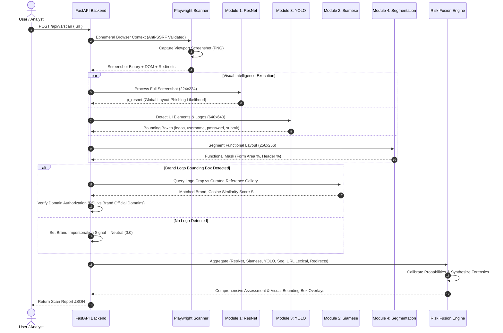

# ARCHITECTURE.md — System Architecture & Component Design

**Project:** PhishVision AI (Phishing Website and Brand Impersonation Detector)  
**Status:** Approved for Baseline Architecture (Phase 0)  
**Last Updated:** 2026-11-22  

---

## 1. High-Level System Architecture & Research Positioning

PhishVision AI is a decoupled, multimodal threat intelligence platform designed to evaluate any submitted URL in real time.

> [!IMPORTANT]
> **Central Research Contribution:**  
> **Visual Intelligence** represents the core scientific and research centerpiece of PhishVision AI. While traditional phishing detection systems rely almost exclusively on reactive domain blocklists or purely lexical URL parsing, PhishVision AI establishes that visual layout semantics, localized UI element co-occurrence, and visual brand identity provide the strongest, most resilient signals against zero-day phishing campaigns and evasive cloaking techniques.

Incoming URLs are safely rendered in an isolated sandbox environment, and their visual artifacts are processed across four independent, specialized computer vision modules alongside lexical and behavioral telemetry before arriving at a calibrated probabilistic risk fusion engine.

```mermaid
flowchart TD
    subgraph Ingress["Client & Ingress Tier"]
        UI["React Dashboard / API Client"]
        API["FastAPI Backend (/api/v1)"]
        VAL["Ingress Normalizer & Anti-SSRF Pre-Filter"]
    end

    subgraph Scanner["Isolated Dynamic Scanner (Phase 1)"]
        SSRF["Anti-SSRF DNS Pinning Engine"]
        PW["Playwright Ephemeral Headless Browser"]
        SHOT["Full Viewport Screenshot Capture (PNG)"]
        DOM["Sanitized DOM & Script Extractor"]
        NET["Redirect Chain & Network Event Interceptor"]
    end

    subgraph CoreVision["CENTRAL RESEARCH CONTRIBUTION: Visual Intelligence Suite"]
        direction TB
        subgraph Mod1["Module 1: General Screenshot Classifier"]
            M02["ResNet-18 / ResNet-50 Classifier<br/>(Global Structural & Layout Assessment)"]
        end

        subgraph Mod3["Module 3: UI Component & Logo Detector"]
            M04["Ultralytics YOLOv8/v11<br/>(BBox Localization: Logos, Inputs, Buttons)"]
        end

        subgraph Mod2["Module 2: Visual Brand Similarity Engine"]
            M03["Siamese CNN (Triplet Metric Learning)<br/>(Logo Embedding vs Reference Gallery)"]
        end

        subgraph Mod4["Module 4: Webpage Region Segmentation"]
            M06["U-Net Semantic Segmenter<br/>(Functional Layout Masks)"]
            M07["YOLO-Seg Instance Segmenter<br/>(Polygon UI Region Isolation)"]
        end
    end

    subgraph SupportingEngines["Supporting Intelligence Engines"]
        URLDomain["URL & Domain Intelligence (PSL, Homoglyph, Entropy, MLP)"]
        Behavior["Behavioral & Redirect Sequence Engine (DOM, LSTM/Transformer)"]
        BrandGallery[("Curated Visual Brand Reference Gallery<br/>(15-20 Target Brands)")]
    end

    subgraph Fusion["Calibrated Decision Tier (Phase 10)"]
        RF["Calibrated Multi-Evidence Risk Fusion Engine"]
        EXP["Explainable Evidence Synthesizer"]
    end

    UI --> API --> VAL --> SSRF --> PW
    PW --> SHOT
    PW --> DOM
    PW --> NET

    SHOT --> Mod1
    SHOT --> Mod3
    SHOT --> Mod4

    Mod3 -->|Detected Logo Crops<br/>(Conditional Trigger)| Mod2
    BrandGallery --> Mod2
    VAL -.->|URL Brand Cues| Mod2

    VAL --> URLDomain
    DOM --> Behavior
    NET --> Behavior

    Mod1 --> Fusion
    Mod2 --> Fusion
    Mod3 --> Fusion
    Mod4 --> Fusion
    URLDomain --> Fusion
    Behavior --> Fusion

    Fusion --> RF --> EXP --> API --> UI
```

---

## 2. Visual Intelligence Subsystem: The Four Independent Modules

The visual intelligence suite consists of four independent modules that evaluate different abstraction levels of a webpage's visual composition.



---

### 2.1 Module 1: ResNet-Based Webpage Screenshot Classification

- **Research Role:** Global semantic visual analysis. Evaluates the webpage's macro visual structure and layout aesthetics without requiring a prior reference screenshot or knowledge of the website's identity.
- **Model Architecture:** ResNet-18 (primary for low-latency live inference) and ResNet-50 (accuracy ablation). The final 1000-class ImageNet linear projection is replaced with `Linear(in_features, 2)` (Legitimate vs. Phishing).
- **Input Specifications:**
  - **Data Type:** Float32 Tensor.
  - **Dimensions:** $3 \times 224 \times 224$ (RGB).
  - **Preprocessing:** Original browser viewport screenshot ($1280 \times 720$) resized to $224 \times 224$ via bilinear interpolation; pixel intensities normalized using ImageNet channel statistics ($\mu = [0.485, 0.456, 0.406]$, $\sigma = [0.229, 0.224, 0.225]$).
- **Output Specifications:**
  - Two-element probability vector $[\hat{p}_{\text{legit}}, \hat{p}_{\text{phish}}]$ via Softmax, producing a continuous scalar visual risk probability $\hat{y}_{\text{resnet}} \in [0.0, 1.0]$.
  - Grad-CAM saliency heatmaps highlighting spatial regions that triggered the classifier.
- **Training Dataset Requirements:**
  - $\sim 10,000$ full-page screenshots split 50/50 between verified legitimate and verified phishing sites across 8 industry verticals.
- **Annotation Requirements:**
  - Binary classification label: `0` (Legitimate) or `1` (Phishing).
  - Cleaned of broken captures, blank white pages, and network timeout error pages.
- **Preprocessing Pipeline:**
  - Viewport capture $\to$ Perceptual deduplication check $\to$ Aspect-preserving crop / bilinear downscale to $224 \times 224 \times 3$ $\to$ Data augmentation during training (random horizontal flip disabled to preserve text readability; slight color jitter $\pm 5\%$, small affine rotation $\pm 3^\circ$, random Erasing $\le 5\%$ of area) $\to$ Tensor normalization.
- **Evaluation Metrics:**
  - Primary: ROC-AUC ($\ge 0.95$), Precision, Recall, Macro F1-score.
  - Calibration metric: Expected Calibration Error (ECE $\le 0.05$).

---

### 2.2 Module 2: Siamese CNN-Based Brand Visual Similarity

- **Research Role:** Fine-grained metric learning for brand impersonation detection. Determines whether a detected visual logo or layout element visually matches an authentic, protected brand asset, even when altered by color inversion, scaling, cropping, or slight perturbations.
- **Model Architecture:** Twin convolutional network sharing identical weights (ResNet-18 backbone truncated after layer 4), followed by an Adaptive Average Pooling layer and a 256-dimensional linear embedding head with $L_2$ vector normalization.
- **Input Specifications:**
  - **Data Type:** Paired Float32 Tensors $(x_{\text{query}}, x_{\text{reference}})$.
  - **Dimensions:** Both images resized to $3 \times 128 \times 128$ (RGB).
  - **Query Image:** Cropped visual region containing a detected brand logo or candidate header mark.
  - **Reference Image:** High-resolution official vector/raster asset from the Curated Brand Reference Gallery.
- **Output Specifications:**
  - 256-dimensional unit embedding vectors $z_{\text{query}}, z_{\text{ref}} \in \mathbb{R}^{256}$ where $\|z\|_2 = 1$.
  - Normalized Cosine Similarity:
    $$S(x_q, x_r) = \frac{z_q \cdot z_r}{\|z_q\| \|z_r\|} \in [-1.0, 1.0]$$
    Mapped to brand distance: $D(x_q, x_r) = \sqrt{2(1 - S(x_q, x_r))} \in [0.0, 2.0]$.
  - Categorical brand identification: $\text{Brand}^* = \arg\max_b S(x_q, x_{\text{ref}}^{(b)})$ subject to $S \ge \tau_{\text{brand}}$ (default threshold $\tau = 0.82$).
- **Training Dataset Requirements:**
  - $\ge 1,000$ curated brand comparison image pairs (positive authentic variants, negative cross-brand pairs, and hard-negative lookalikes) covering 15–20 selected high-value brands.
- **Annotation Requirements:**
  - Triplet or pair tuples: `(anchor_path, positive_path, negative_path)` or `(query_path, ref_path, label in {0, 1})` with associated `brand_id`.
- **Preprocessing Pipeline:**
  - Bounding box crop extraction from raw screenshot $\to$ Square padding with alpha preservation $\to$ Bilinear resize to $128 \times 128$ $\to$ Augmentation (brightness jitter $\pm 10\%$, perspective transform $\pm 5\%$, background synthesis on transparent alpha PNGs) $\to$ Standard channel normalization.
- **Evaluation Metrics:**
  - Top-1 and Top-3 Brand Retrieval Accuracy ($\ge 0.92$), Area Under the ROC Curve (ROC-AUC), Mean Reciprocal Rank (MRR), False Match Rate (FMR) at fixed False Non-Match Rate (FNMR $\le 0.01$).

---

### 2.3 Module 3: YOLO-Based Logo & Webpage Component Detection

- **Research Role:** Real-time spatial object detection. Localizes critical functional UI components (brand logos, username fields, password inputs, submit buttons, and payment QR codes) and delivers precise bounding boxes and class confidences.
- **Model Architecture:** Ultralytics YOLOv8 / YOLOv11 single-stage anchor-free detector (YOLOv8s or YOLOv11s backbone with PAN-FPN neck and decoupled detection head).
- **Input Specifications:**
  - **Data Type:** Float32 Tensor.
  - **Dimensions:** $3 \times 640 \times 640$ (RGB).
  - **Preprocessing:** Original screenshot padded to square using letterbox padding (preserving original aspect ratio), resized to $640 \times 640$, normalized to $[0.0, 1.0]$.
- **Output Specifications:**
  - Tensor of shape $N \times 6$: $[x_1, y_1, x_2, y_2, \text{confidence}, \text{class\_id}]$ where coordinates are in pixel space.
  - Target Classes:
    - `0: brand_logo`
    - `1: username_input`
    - `2: password_input`
    - `3: submit_button`
    - `4: qr_code`
- **Training Dataset Requirements:**
  - $\sim 1,500$ annotated webpage screenshots with dense bounding boxes across both legitimate and phishing pages.
- **Annotation Requirements:**
  - YOLO format text files (`<class_id> <x_center> <y_center> <width> <height>` normalized $[0, 1]$) with strict bounding coordinates around UI elements.
- **Preprocessing Pipeline:**
  - High-res screenshot capture ($1280 \times 720$) $\to$ Letterbox padding to square $1280 \times 1280$ with neutral gray fill $\to$ Resize to $640 \times 640$ $\to$ Mosaic augmentation, MixUp ($\alpha=0.1$), random HSV shift $\to$ Coordinate normalization.
- **Evaluation Metrics:**
  - Mean Average Precision (mAP@50 $\ge 0.85$, mAP@50-95 $\ge 0.65$), Per-class Average Precision (specifically for `brand_logo` and `password_input`), inference latency ($\le 25$ ms on GPU).

---

### 2.4 Module 4: U-Net Semantic Segmentation & YOLO Instance Segmentation

- **Research Role:** Structural layout and visual region topology analysis. Partitions the webpage into functional zones (header banner, navigation bar, credential form container, footer, copyright zone) to quantify structural anomalies (e.g., disproportionately large floating login forms, missing standard corporate navigation, fake footer badges).
- **Model Architectures:**
  - **U-Net:** Encoder-decoder network with skip connections (ResNet-34 encoder pretrained on ImageNet) outputting dense pixel masks.
  - **YOLO-Seg:** Ultralytics YOLOv8-Seg predicting bounding boxes plus instance polygon masks for individual form containers and logos.
- **Input Specifications:**
  - **Data Type:** Float32 Tensor.
  - **Dimensions:** $3 \times 256 \times 256$ for U-Net; $3 \times 640 \times 640$ for YOLO-Seg.
  - **Preprocessing:** Downscaled with bilinear interpolation and channel normalization.
- **Output Specifications:**
  - **U-Net:** Pixel-level class probability map $C \times 256 \times 256$ representing 5 semantic classes: `[0: background, 1: header, 2: credential_form, 3: body_content, 4: footer]`.
  - **YOLO-Seg:** Segment instance masks with class labels, polygon contours, and percentage of total viewport surface area occupied.
- **Training Dataset Requirements:**
  - $\sim 1,000$ webpage screenshots with pixel-level polygon segment annotations.
- **Annotation Requirements:**
  - COCO Segmentation JSON format (polygon coordinate sequences `[x1, y1, x2, y2, ...]`) and pixel-level 8-bit PNG mask images.
- **Preprocessing Pipeline:**
  - Bilinear resize $\to$ Random crop and pad $\to$ Elastic deformations and grid distortions during training $\to$ Mask binarization and one-hot encoding.
- **Evaluation Metrics:**
  - Mean Intersection over Union (mIoU $\ge 0.80$), Dice Coefficient ($\ge 0.85$), Mask mAP@50.

---

## 3. Integration of Visual Intelligence Outputs

The outputs of the four visual modules are not evaluated in isolation. They form a cohesive, multi-level visual evidence graph that feeds directly into the Calibrated Risk Fusion Engine.



### Visual Feature Synthesis Rules:
1. **Logo-Form Spatial Co-occurrence:** If YOLO detects a `brand_logo` whose vertical center is within 250px above a `password_input` inside a single form bounding box, this activates a high-risk credential-harvesting spatial pattern.
2. **Conditional Brand Impersonation Mismatch:**
   $$\text{Impersonation Risk} = \begin{cases} 
   1.0 & \text{if } S(\text{logo}, \text{brand}) \ge \tau_{\text{brand}} \text{ AND } \text{domain} \notin \text{BrandAuthorizedDomains} \\
   0.0 & \text{if } S(\text{logo}, \text{brand}) \ge \tau_{\text{brand}} \text{ AND } \text{domain} \in \text{BrandAuthorizedDomains} \\
   0.0 & \text{if no brand logo detected (Neutral)}
   \end{cases}$$
3. **Layout Anomaly Factor (Segmentation):** Phishing login pages typically exhibit disproportionately high form-to-page surface ratios ($\ge 40\%$ of viewport area) with sparse or absent navigation headers ($\le 5\%$), whereas legitimate homepages maintain balanced layouts.

---

## 4. Handling Unknown & Zero-Day Websites Without Whitelists

A foundational principle of PhishVision AI is that **the system must never require a pre-existing screenshot or entry for every legitimate website on the internet.**



### Principles for Unknown Domain Evaluation:
1. **Independent General Classification (ResNet):** Module 1 is trained on high-level visual features: visual noise, typography anomalies, layout fragmentation, stolen stock themes, low-resolution badges, and high-contrast credential submission buttons. It produces a valid, calibrated risk score on completely novel domains.
2. **Structural Primitives (YOLO & U-Net):** Even on an unknown domain, the system recognizes when a page presents a credential harvesting interface (login fields + submit button) and measures its spatial dominance.
3. **Strictly Conditional Brand Matching:** Brand matching (Module 2) is **only activated** if:
   - Module 3 detects a logo candidate with confidence $\ge 0.60$, OR
   - URL lexical analysis detects typosquatting/homoglyph cues suggesting a specific brand.
   If no brand identity is claimed or detected, Module 2 outputs a neutral score ($0.0$), ensuring that novel, legitimate small-business or personal websites are never penalized simply because they are not in the brand reference gallery.

---

## 5. Curated Visual Brand Reference Dataset

To support Module 2 without maintaining an internet-wide database, PhishVision AI establishes a targeted **Curated Visual Brand Reference Gallery** for 15–20 high-value, frequently impersonated institutions:

- **Storage Location:** `data/brands/reference_gallery/`
- **Candidate Target Brands (15–20):**
  1. State Bank of India (`sbi`)
  2. HDFC Bank (`hdfc`)
  3. PayPal (`paypal`)
  4. Microsoft (`microsoft`)
  5. Google (`google`)
  6. Apple (`apple`)
  7. Amazon (`amazon`)
  8. Chase Bank (`chase`)
  9. Wells Fargo (`wellsfargo`)
  10. Netflix (`netflix`)
  11. Meta / Facebook (`facebook`)
  12. Instagram (`instagram`)
  13. WhatsApp (`whatsapp`)
  14. Bank of America (`bofa`)
  15. DHL Express (`dhl`)
  16. FedEx (`fedex`)
  17. LinkedIn (`linkedin`)
  18. Adobe (`adobe`)

### Reference Asset Schema Per Brand:
Each brand directory contains:
```
data/brands/reference_gallery/<brand_id>/
├── metadata.json                 # Brand ID, official domains, aliases, industry
├── logos/
│   ├── logo_primary.png          # Transparent high-resolution primary mark
│   ├── logo_monochrome.png       # Dark/light monochrome variants
│   ├── logo_icon_only.png        # Favicon / standalone emblem
│   └── vector_master.svg         # Ground-truth scalable vector asset
├── canonical_screenshots/
│   ├── login_desktop_1080p.png   # Ground-truth authentic login page capture
│   └── home_desktop_1080p.png    # Ground-truth authentic homepage capture
└── embeddings/
    └── reference_embeddings.npy  # Pre-computed 256-d Siamese embedding vectors
```

---

## 6. End-to-End Scan Sequence Flow with Visual Intelligence



---

## 7. Failure Modes & Resilience Strategies

| Failure Scenario | Impact | Mitigation Strategy | Resulting Verdict State |
| :--- | :--- | :--- | :--- |
| Dynamic screenshot capture times out / fails | Visual modules cannot run | Graceful fallback: URL intelligence and redirect analysis proceed; visual tier flagged unavailable. | `UNKNOWN / INSUFFICIENT EVIDENCE (DYNAMIC SCAN FAILED)` |
| Brand logo detected on authentic official domain | False positive risk | Domain Association check verifies registrable domain is in brand's whitelist; sets impersonation risk = 0.0. | Correctly classified as `LEGITIMATE` |
| Webpage has no logos and novel design | Unseen small-business website | Siamese matching bypassed; ResNet evaluates generalized layout; if layout & forms are normal, risk is low. | Correctly classified as `LEGITIMATE` |
| Attacker slightly perturbs or recolors logo | Visual evasion attempt | Siamese CNN trained with Triplet Loss on color/rotation perturbations; matches vector embedding within margin $\tau$. | Correctly classified as `PHISHING` |
| Low resolution / blurry screenshot | Degraded detection precision | Image quality check; bicubic upsampling + contrast enhancement applied before detection. | Processed with uncertainty warning |
