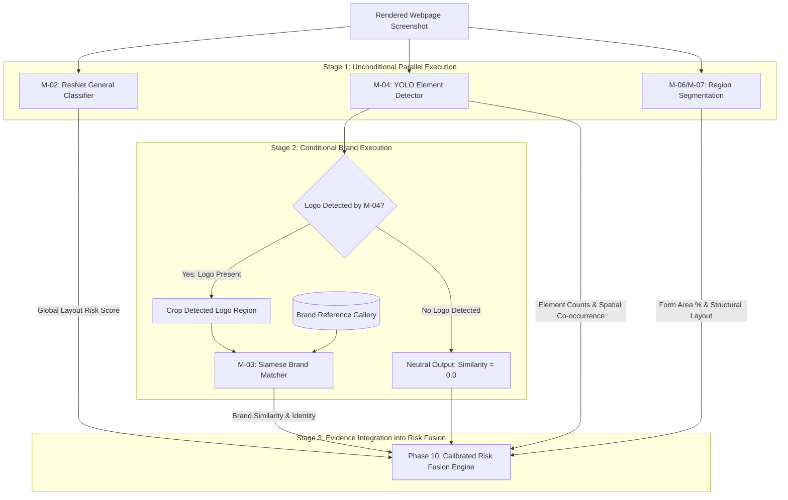

# MODEL_REGISTRY.md — Machine Learning Model Registry & Specifications

**Project:** PhishVision AI (Phishing Website and Brand Impersonation Detector)  
**Status:** Approved for Baseline Architecture (Phase 0)  
**Last Updated:** 2026-11-22  

---

## 1. Complete Model Inventory & Research Structure

Visual intelligence forms the central empirical contribution of PhishVision AI. The system plans 10 distinct neural network models organized into two operational tiers:

> [!IMPORTANT]
> **GAN Exclusion:** Generative Adversarial Networks (GANs) are permanently removed from this project. VAE (M-10) is the sole generative model.

| ID | Model & Visual Module | Architecture Base | Operational Role | Training Regime | Target Evaluation Metric |
| :--- | :--- | :--- | :--- | :--- | :--- |
| **M-01** | URL Lexical Baseline | 3-Layer MLP | Production (Fast-path) | Trained from scratch | Macro F1 $\ge 0.90$ |
| **M-02** | **Visual Module 1: Screenshot Classifier** | ResNet-18 / ResNet-50 | Production (Vision Core) | Pretrained (ImageNet) + Fine-tuned | ROC-AUC $\ge 0.95$, ECE $\le 0.05$ |
| **M-03** | **Visual Module 2: Brand Similarity Matcher** | Siamese CNN (ResNet-18 backbone) | Production (Conditional Brand) | Fine-tuned with Triplet Loss | Top-1 Accuracy $\ge 0.92$, FMR $\le 0.01$ |
| **M-04** | **Visual Module 3: UI Component & Logo Detector**| Ultralytics YOLOv8/v11 | Production (Spatial Vision) | Pretrained (COCO) + Fine-tuned | mAP@50 $\ge 0.85$, Latency $\le 25$ ms |
| **M-05** | Comparative Object Detector | Faster R-CNN (ResNet-50-FPN) | Academic Benchmark (Offline) | Pretrained + Fine-tuned | mAP@50-95 comparison |
| **M-06** | **Visual Module 4A: Semantic Segmenter** | U-Net (ResNet-34 encoder) | Offline / Forensics Analysis | Pretrained + Fine-tuned | mIoU $\ge 0.80$, Dice $\ge 0.85$ |
| **M-07** | **Visual Module 4B: Instance Segmenter** | YOLO-Seg (YOLOv8-Seg) | Production / Forensics | Pretrained + Fine-tuned | Mask mAP@50 $\ge 0.82$ |
| **M-08** | Redirect Sequence Classifier | Bidirectional LSTM | Production (Sequence Tier) | Trained from scratch | Macro F1 $\ge 0.88$ |
| **M-09** | Sequence Comparator | Transformer Encoder | Academic Benchmark (Offline) | Trained from scratch | Macro F1 $\ge 0.90$ |
| **M-10** | Latent Space Explorer | Variational Autoencoder (VAE) | Offline Generative Sandbox | Trained from scratch | ELBO / Reconstruction Loss |

---

## 2. Model Specifications & Operational Architectures

### 2.0 M-01: URL Lexical Multi-Layer Perceptron (Fast-Path Tier)
- **Role:** Fast-path lexical URL and domain verification. Operates in real-time ($<2$ ms) before browser launch to preemptively flag blatant phishing domains or provide calibrated prior probabilities for multimodal risk fusion.
- **Architecture:** 3-Layer Dense Perceptron trained from scratch:
  - Input Layer: 40 engineered lexical, structural, and brand-impersonation features.
  - Hidden Layer 1: `Dense(40, 64)` $\to$ `ReLU` (He normal initialization).
  - Hidden Layer 2: `Dense(64, 32)` $\to$ `ReLU` (He normal initialization).
  - Output Layer: `Dense(32, 1)` $\to$ `Sigmoid` (Xavier initialization).
- **Optimization & Schedulers:** Custom `Adam` ($\beta_1=0.9, \beta_2=0.999$) with `CosineAnnealingLR` from scratch; cost-sensitive class-weighted BCE ($w_0 = 36.962, w_1 = 0.507$) under natural distribution mini-batching (Strategy B) with best-validation-checkpoint restoration.
- **Integrated Domain Intelligence:**
  - PSL multi-label domain parsing (`app/intelligence/url_domain/psl_extractor.py`).
  - Unicode mixed-script and confusable homoglyph analysis (`app/intelligence/url_domain/homoglyph.py`).
  - Typosquatting, combosquatting, and subdomain spoofing detection (`app/intelligence/url_domain/typosquatting.py`).
- **Holdout Evaluation Metrics (Unseen Test Partition, 4,257 samples across 908 unseen domains):**
  - **ROC-AUC:** 0.9773
  - **PR-AUC:** 0.9995
  - **Macro F1:** 0.8239
  - **Accuracy:** 98.66%
  - **Phishing (Class 1):** Precision 0.9933, Recall 0.9931, F1 0.9932
  - **Legitimate (Class 0):** Precision 0.6506, Recall 0.6585, F1 0.6545
- **Artifacts:** `models/lexical/model_weights.npz`, `models/lexical/preprocessor.json`, `models/lexical/feature_names.json`.

### 2.1 M-02: ResNet Screenshot Classifier (Visual Module 1)
- **Role:** Independent global layout classification. Operates unconditionally on any rendered webpage screenshot without requiring prior knowledge or reference images of the target domain.
- **Backbone Architecture:** ResNet-18 (ImageNet pretrained or scratch options). Head: `AdaptiveAvgPool2d(1)` $\to$ `Flatten` $\to$ `Linear(512, 128)` $\to$ `ReLU` $\to$ `Dropout(0.3)` $\to$ `Linear(128, 2)`. Explicit class mapping `0: legitimate, 1: phishing`.
- **Input Specifications:**
  - Shape: $B \times 3 \times 224 \times 224$ (Float32).
  - Preprocessing: Configurable `TopViewportCrop` (1:1 viewport ratio focusing on login/brand fold) or `AspectRatioPadResize` to preserve aspect ratio without stretching; normalized with ImageNet channel means $[0.485, 0.456, 0.406]$ and standard deviations $[0.229, 0.224, 0.225]$.
- **Output Specifications:**
  - Two-element logits/probabilities vector $[\hat{p}_{\text{legit}}, \hat{p}_{\text{phish}}]$ where visual risk score is $\hat{y}_{\text{resnet}} \in [0.0, 1.0]$.
- **Training Dataset & Split Integrity:**
  - 1,000 valid screenshots on disk (`data/splits/visual/`) with strict domain isolation:
    - `train.parquet`: 624 samples (477 phishing, 147 legitimate, 362 unique domains)
    - `val.parquet`: 262 samples (236 phishing, 26 legitimate, 76 unique domains)
    - `test.parquet`: 114 samples (87 phishing, 27 legitimate, 79 unique domains)
    - Zero domain leakage, zero exact SHA-256 duplicate overlap, zero perceptual pHash overlap.
- **Optimization Strategy:** AdamW optimizer with weight decay $0.01$, learning rate $1 \times 10^{-4}$, Cosine Annealing learning rate schedule, dynamic class-weighted CrossEntropyLoss ($w_c = N / (2 \cdot N_c)$), early stopping on validation loss, and best-checkpoint restoration.
- **Implementation Modules:**
  - Architecture: [`app/ml/vision/models.py`](app/ml/vision/models.py)
  - Preprocessing: [`app/ml/vision/preprocessing.py`](app/ml/vision/preprocessing.py)
  - Dataset: [`app/ml/vision/dataset.py`](app/ml/vision/dataset.py)
  - Metrics & Evaluation: [`app/ml/vision/evaluation.py`](app/ml/vision/evaluation.py)
  - Trainer: [`app/ml/vision/trainer.py`](app/ml/vision/trainer.py)
  - Inference: [`app/ml/vision/inference.py`](app/ml/vision/inference.py)
  - CLI & Config: [`configs/resnet18.yaml`](configs/resnet18.yaml), [`app/ml/train_resnet18.py`](app/ml/train_resnet18.py)
- **Status:** **Implementation and Unit Testing Complete (15 passed). Training execution pending manual trigger.**
- **Manual Training Command:**
  ```powershell
  & "C:\Users\hp\PycharmProjects\blansole_footscan\.venv\Scripts\python.exe" -m app.ml.train_resnet18 --config configs/resnet18.yaml
  ```

---

### 2.2 M-03: Siamese CNN Brand Visual Matcher (Visual Module 2)
- **Role:** Metric learning engine for brand impersonation. Activated **conditionally** when a logo candidate is detected by YOLO (M-04) or suggested by lexical domain analysis.
- **Backbone Architecture:** Shared twin ResNet-18 backbone truncated after Layer 4. Embedding head: `AdaptiveAvgPool2d` $\to$ `Linear(512, 256)` $\to$ $L_2$ Normalization Layer ($\|z\|_2 = 1.0$).
- **Loss Function:** Combined Triplet Margin Loss with hard negative mining:
  $$\mathcal{L}(a, p, n) = \max\left(0, \|z_a - z_p\|_2^2 - \|z_a - z_n\|_2^2 + \alpha\right), \quad \alpha = 0.3$$
- **Input Specifications:**
  - Query image $x_q$: Cropped logo bounding box from screenshot ($128 \times 128 \times 3$).
  - Reference image $x_r$: Canonical logo from `data/brands/reference_gallery/` ($128 \times 128 \times 3$).
- **Output Specifications:**
  - 256-dimensional unit embedding vectors $z_q, z_r$.
  - Cosine Similarity: $S(x_q, x_r) = z_q \cdot z_r \in [-1.0, 1.0]$.
  - Identification Verdict: $\text{Brand}^* = \arg\max_b S(x_q, x_{\text{ref}}^{(b)})$ if $\max S \ge 0.82$, else `UNIDENTIFIED_OR_NEUTRAL`.
- **Domain Authorization Integration:**
  - If $\text{Brand}^*$ identified AND current registrable domain $\notin \text{AuthorizedDomains}(\text{Brand}^*)$, flag `CRITICAL: Brand Impersonation Mismatch`.
- **Training Dataset & Annotations:**
  - $\ge 1,000$ paired crops from `data/manifests/manifest_siamese_pairs.csv` (authentic positive variants, attacker lookalike negatives, and cross-brand negatives).
- **Evaluation Metrics:** Top-1 Retrieval Accuracy ($\ge 0.92$), Area Under the ROC Curve, False Match Rate (FMR $\le 0.01$).

---

### 2.3 M-04: Ultralytics YOLO UI Element & Logo Detector (Visual Module 3)
- **Role:** Real-time spatial object detection. Localizes visual components essential for credential harvesting and branding.
- **Backbone Architecture:** Ultralytics YOLOv8s / YOLOv11s (single-stage, anchor-free, decoupled head).
- **Classes:**
  - `0: brand_logo`
  - `1: username_input`
  - `2: password_input`
  - `3: submit_button`
  - `4: qr_code`
- **Input Specifications:**
  - Shape: $B \times 3 \times 640 \times 640$ (Float32, normalized $[0.0, 1.0]$).
  - Preprocessing: Letterbox square padding preserving original aspect ratio.
- **Output Specifications:**
  - List of detected objects: `[{ class_name, confidence, bbox: [x1, y1, x2, y2] }]`.
  - Spatial relationships: Computes vertical/horizontal distance between detected logos and password input fields.
- **Training Dataset & Annotations:**
  - 1,500 annotated webpage screenshots with bounding boxes in YOLO format (`.txt` per image).
- **Evaluation Metrics:** mAP@50 ($\ge 0.85$), mAP@50-95 ($\ge 0.65$), Per-class Average Precision, GPU latency ($\le 25$ ms).

---

### 2.4 M-06 & M-07: U-Net & YOLO-Seg Layout Segmenters (Visual Module 4)
- **Role:** Webpage region topology analysis. Partitions the visual surface into functional layout zones to detect anomalous layout structures (e.g. login form occupying $>40\%$ of the screen with no headers).
- **Architectures:**
  - **M-06 (U-Net):** Encoder-decoder with skip connections (ResNet-34 encoder), predicting dense pixel masks for 5 semantic classes (`background`, `header`, `credential_form`, `body`, `footer`).
  - **M-07 (YOLO-Seg):** Ultralytics YOLOv8-Seg predicting instance polygon masks for distinct UI containers.
- **Input Specifications:**
  - U-Net: $B \times 3 \times 256 \times 256$ (Float32).
  - YOLO-Seg: $B \times 3 \times 640 \times 640$ (Float32).
- **Output Specifications:**
  - Dense class mask and regional area percentages: `form_area_pct`, `header_area_pct`, `footer_area_pct`.
- **Training Dataset & Annotations:**
  - 1,000 screenshots annotated with COCO JSON polygon contours and 8-bit semantic PNG masks.
- **Evaluation Metrics:** Mean Intersection over Union (mIoU $\ge 0.80$), Dice Coefficient ($\ge 0.85$).

---

## 3. Visual Intelligence Execution & Dependency Graph



---

## 4. Handling Unknown & Zero-Day Websites

PhishVision AI is explicitly engineered to handle completely unknown websites without requiring a reference screenshot for every domain on the internet:

1. **Unconditional General Classification (M-02 ResNet):** Evaluates visual primitives of phishing (visual clutter, mismatched fonts, low-fidelity graphics, stolen templates) learned across thousands of diverse samples. It provides an independent risk probability regardless of brand presence.
2. **Structural Anomaly Quantification (M-04 YOLO & M-06 U-Net):** Identifies credential-harvesting mechanisms (password inputs, login forms) and verifies whether their visual presentation exhibits aggressive, phishing-like spatial dominance.
3. **Conditional Brand Matching (M-03 Siamese):** If a website does not claim or display a known brand logo, M-03 remains neutral. Novel, legitimate small-business sites are evaluated purely on their structural visual integrity and lexical/behavioral evidence.
