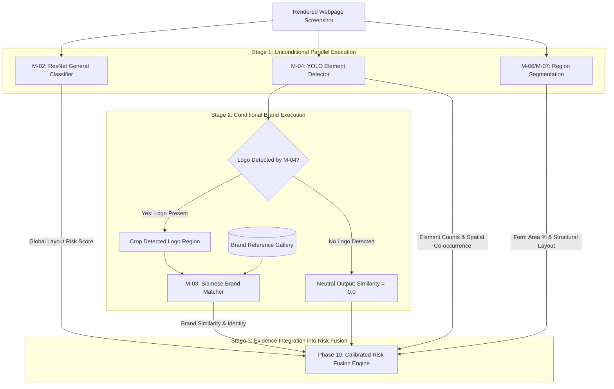

# MODEL_REGISTRY.md — Machine Learning Model Registry & Specifications

**Project:** PhishVision AI (Phishing Website and Brand Impersonation Detector)  
**Status:** Approved for Baseline Architecture (Phase 0)  
**Last Updated:** 2026-11-22  

---

## 1. Complete Model Inventory & Research Structure

Visual intelligence forms the central empirical contribution of PhishVision AI. The system plans 10 distinct neural network models organized into two operational tiers:

> [!IMPORTANT]
> **GAN Exclusion:** Generative Adversarial Networks (GANs) are permanently removed from this project. VAE (M-10) is the sole generative model.

| ID | Model & Visual Module | Architecture Base | Operational Role | Training Regime | Target Evaluation Metric |
| :--- | :--- | :--- | :--- | :--- | :--- |
| **M-01** | URL Lexical Baseline | 3-Layer MLP | Production (Fast-path) | Trained from scratch | Macro F1 $\ge 0.90$ |
| **M-02** | **Visual Module 1: Screenshot Classifier** | ResNet-18 / ResNet-50 | Production (Vision Core) | Pretrained (ImageNet) + Fine-tuned | ROC-AUC $\ge 0.95$, ECE $\le 0.05$ |
| **M-03** | **Visual Module 2: Brand Similarity Matcher** | Siamese CNN (ResNet-18 backbone) | Production (Conditional Brand) | Fine-tuned with Triplet Loss | Top-1 Accuracy $\ge 0.92$, FMR $\le 0.01$ |
| **M-04** | **Visual Module 3: UI Component & Logo Detector**| Ultralytics YOLOv8/v11 | Production (Spatial Vision) | Pretrained (COCO) + Fine-tuned | mAP@50 $\ge 0.85$, Latency $\le 25$ ms |
| **M-05** | Comparative Object Detector | Faster R-CNN (ResNet-50-FPN) | Academic Benchmark (Offline) | Pretrained + Fine-tuned | mAP@50-95 comparison |
| **M-06** | **Visual Module 4A: Semantic Segmenter** | U-Net (ResNet-34 encoder) | Offline / Forensics Analysis | Pretrained + Fine-tuned | mIoU $\ge 0.80$, Dice $\ge 0.85$ |
| **M-07** | **Visual Module 4B: Instance Segmenter** | YOLO-Seg (YOLOv8-Seg) | Production / Forensics | Pretrained + Fine-tuned | Mask mAP@50 $\ge 0.82$ |
| **M-08** | Redirect Sequence Classifier | Bidirectional LSTM | Production (Sequence Tier) | Trained from scratch | Macro F1 $\ge 0.88$ |
| **M-09** | Sequence Comparator | Transformer Encoder | Academic Benchmark (Offline) | Trained from scratch | Macro F1 $\ge 0.90$ |
| **M-10** | Latent Space Explorer | Variational Autoencoder (VAE) | Offline Generative Sandbox | Trained from scratch | ELBO / Reconstruction Loss |

---

## 2. Model Specifications & Operational Architectures

### 2.0 M-01: URL Lexical Multi-Layer Perceptron (Fast-Path Tier)
- **Role:** Fast-path lexical URL and domain verification. Operates in real-time ($<2$ ms) before browser launch to preemptively flag blatant phishing domains or provide calibrated prior probabilities for multimodal risk fusion.
- **Architecture:** 3-Layer Dense Perceptron trained from scratch:
  - Input Layer: 40 engineered lexical, structural, and brand-impersonation features.
  - Hidden Layer 1: `Dense(40, 64)` $\to$ `ReLU` (He normal initialization).
  - Hidden Layer 2: `Dense(64, 32)` $\to$ `ReLU` (He normal initialization).
  - Output Layer: `Dense(32, 1)` $\to$ `Sigmoid` (Xavier initialization).
- **Optimization & Schedulers:** Custom `Adam` ($\beta_1=0.9, \beta_2=0.999$) with `CosineAnnealingLR` from scratch; cost-sensitive class-weighted BCE ($w_0 = 36.962, w_1 = 0.507$) under natural distribution mini-batching (Strategy B) with best-validation-checkpoint restoration.
- **Integrated Domain Intelligence:**
  - PSL multi-label domain parsing (`app/intelligence/url_domain/psl_extractor.py`).
  - Unicode mixed-script and confusable homoglyph analysis (`app/intelligence/url_domain/homoglyph.py`).
  - Typosquatting, combosquatting, and subdomain spoofing detection (`app/intelligence/url_domain/typosquatting.py`).
- **Holdout Evaluation Metrics (Unseen Test Partition, 4,257 samples across 908 unseen domains):**
  - **ROC-AUC:** 0.9773
  - **PR-AUC:** 0.9995
  - **Macro F1:** 0.8239
  - **Accuracy:** 98.66%
  - **Phishing (Class 1):** Precision 0.9933, Recall 0.9931, F1 0.9932
  - **Legitimate (Class 0):** Precision 0.6506, Recall 0.6585, F1 0.6545
- **Artifacts:** `models/lexical/model_weights.npz`, `models/lexical/preprocessor.json`, `models/lexical/feature_names.json`.

### 2.1 M-02: ResNet Screenshot Classifier (Visual Module 1)
- **Role:** Independent global layout classification. Operates unconditionally on any rendered webpage screenshot without requiring prior knowledge or reference images of the target domain.
- **Backbone Architecture:** ResNet-18 (ImageNet pretrained or scratch options). Head: `AdaptiveAvgPool2d(1)` $\to$ `Flatten` $\to$ `Linear(512, 128)` $\to$ `ReLU` $\to$ `Dropout(0.3)` $\to$ `Linear(128, 2)`. Explicit class mapping `0: legitimate, 1: phishing`.
- **Input Specifications:**
  - Shape: $B \times 3 \times 224 \times 224$ (Float32).
  - Preprocessing: Configurable `TopViewportCrop` (1:1 viewport ratio focusing on login/brand fold) or `AspectRatioPadResize` to preserve aspect ratio without stretching; normalized with ImageNet channel means $[0.485, 0.456, 0.406]$ and standard deviations $[0.229, 0.224, 0.225]$.
- **Output Specifications:**
  - Two-element logits/probabilities vector $[\hat{p}_{\text{legit}}, \hat{p}_{\text{phish}}]$ where visual risk score is $\hat{y}_{\text{resnet}} \in [0.0, 1.0]$.
- **Training Dataset & Split Integrity:**
  - 1,000 valid screenshots on disk (`data/splits/visual/`) with strict domain isolation:
    - `train.parquet`: 624 samples (477 phishing, 147 legitimate, 362 unique domains)
    - `val.parquet`: 262 samples (236 phishing, 26 legitimate, 76 unique domains)
    - `test.parquet`: 114 samples (87 phishing, 27 legitimate, 79 unique domains)
    - Zero domain leakage, zero exact SHA-256 duplicate overlap, zero perceptual pHash overlap.
- **Optimization Strategy:** AdamW optimizer with weight decay $0.01$, learning rate $1 \times 10^{-4}$, Cosine Annealing learning rate schedule, dynamic class-weighted CrossEntropyLoss ($w_c = N / (2 \cdot N_c)$), early stopping on validation loss, and best-checkpoint restoration.
- **Implementation Modules:**
  - Architecture: [`app/ml/vision/models.py`](app/ml/vision/models.py)
  - Preprocessing: [`app/ml/vision/preprocessing.py`](app/ml/vision/preprocessing.py)
  - Dataset: [`app/ml/vision/dataset.py`](app/ml/vision/dataset.py)
  - Metrics & Evaluation: [`app/ml/vision/evaluation.py`](app/ml/vision/evaluation.py)
  - Trainer: [`app/ml/vision/trainer.py`](app/ml/vision/trainer.py)
  - Inference: [`app/ml/vision/inference.py`](app/ml/vision/inference.py)
  - CLI & Config: [`configs/resnet18.yaml`](configs/resnet18.yaml), [`app/ml/train_resnet18.py`](app/ml/train_resnet18.py)
- **Status:** **Implementation and Unit Testing Complete (15 passed). Training execution pending manual trigger.**
- **Manual Training Command:**
  ```powershell
  & "C:\Users\hp\PycharmProjects\blansole_footscan\.venv\Scripts\python.exe" -m app.ml.train_resnet18 --config configs/resnet18.yaml
  ```

---

### 2.2 M-03: Siamese CNN Brand Visual Matcher (Visual Module 2)
- **Role:** Metric learning engine for brand impersonation. Activated **conditionally** when a logo candidate is detected by YOLO (M-04) or suggested by lexical domain analysis.
- **Backbone Architecture:** Shared twin ResNet-18 backbone truncated after Layer 4. Embedding head: `AdaptiveAvgPool2d` $\to$ `Linear(512, 256)` $\to$ $L_2$ Normalization Layer ($\|z\|_2 = 1.0$).
- **Loss Function:** Combined Triplet Margin Loss with hard negative mining:
  $$\mathcal{L}(a, p, n) = \max\left(0, \|z_a - z_p\|_2^2 - \|z_a - z_n\|_2^2 + \alpha\right), \quad \alpha = 0.3$$
- **Input Specifications:**
  - Query image $x_q$: Cropped logo bounding box from screenshot ($128 \times 128 \times 3$).
  - Reference image $x_r$: Canonical logo from `data/brands/reference_gallery/` ($128 \times 128 \times 3$).
- **Output Specifications:**
  - 256-dimensional unit embedding vectors $z_q, z_r$.
  - Cosine Similarity: $S(x_q, x_r) = z_q \cdot z_r \in [-1.0, 1.0]$.
  - Identification Verdict: $\text{Brand}^* = \arg\max_b S(x_q, x_{\text{ref}}^{(b)})$ if $\max S \ge 0.82$, else `UNIDENTIFIED_OR_NEUTRAL`.
- **Domain Authorization Integration:**
  - If $\text{Brand}^*$ identified AND current registrable domain $\notin \text{AuthorizedDomains}(\text{Brand}^*)$, flag `CRITICAL: Brand Impersonation Mismatch`.
- **Training Dataset & Annotations:**
  - 116 authentic pairs (46 positive, 70 negative) from `data/brands/manifest_siamese_pairs.csv` across all 18 target brands (33 authentic assets).
  - Partitioned with verified zero-leakage into `data/splits/siamese/`: Train (73 pairs across 12 brands), Val (23 pairs across 3 brands), Test (20 pairs across 3 brands).
  - Acquisition pipeline: `scripts/datasets/run_brand_acquisition.py` and `app/ml/vision/brand_pairs.py`.
- **Implementation Status:** COMPLETE & READY TO TRAIN (Assets acquired, pairs partitioned, zero training executed).
- **Execution Command (when assets acquired):**
  ```powershell
  & "C:\Users\hp\PycharmProjects\blansole_footscan\.venv\Scripts\python.exe" -m app.ml.train_siamese --config configs/siamese.yaml
  ```
- **Evaluation Metrics:** Top-1 Retrieval Accuracy ($\ge 0.92$), Area Under the ROC Curve, Precision, Recall, Macro F1 at $\tau = 0.82$, False Match Rate (FMR $\le 0.01$).

---

### 2.3 M-04: Ultralytics YOLO UI Element & Logo Detector (Visual Module 3)
- **Role:** Real-time spatial object detection. Localizes visual components essential for credential harvesting and branding. Directly feeds detected `brand_logo` crops to M-03 Siamese matcher.
- **Backbone Architecture:** Ultralytics YOLOv8n (Nano, ~3.2M params) or YOLO11n (~2.6M params), single-stage, anchor-free decoupled head.
- **Classes (Standardized 6-Class Taxonomy):**
  - `0: brand_logo`
  - `1: login_form`
  - `2: username_field`
  - `3: password_field`
  - `4: submit_button`
  - `5: payment_element`
- **Input Specifications:**
  - Shape: $B \times 3 \times 512 \times 512$ (or $640 \times 640$, Float32/FP16, normalized $[0.0, 1.0]$).
  - Preprocessing: Letterbox square padding preserving original aspect ratio.
- **Output Specifications:**
  - List of detected objects: `[{ class_id, class_name, confidence, bbox: [x1, y1, x2, y2] }]`.
  - Bounding box crops forwarded conditionally to M-03 for brand similarity verification.
  - Spatial relationships: Computes vertical/horizontal distance and topological containment between `login_form` and credential inputs.
- **Dataset & Annotations:**
  - Phase 7.1 Canonical Manifest: 1,008 catalogued real screenshots tracked as `UNANNOTATED` (`data/annotations/detection/annotation_manifest.csv`).
  - Phase 7.2–7.4 Synthetic Dataset: 800 programmatic synthetic screenshots across 6 layout templates (`standard_login`, `banking_login`, `social_login`, `ecommerce_login`, `payment_checkout`, and empty pages) with exact bounding boxes in `data/synthetic_yolo/` (Train: 560, Val: 120, Test: 120).
- **Controlled Synthetic Experiment Notice:**
  - The synthetic dataset serves as a reproducible proof-of-concept for bounding-box coordinate learning, anchor-free detection convergence, and multi-class UI element parsing. Its benchmark metrics do NOT represent real-world phishing detection accuracy.
- **Hardware-Aware Training Configuration (RTX 2050 4GB VRAM):**
  - Batch size: 4, Resolution: 512, Workers: 2, Mixed Precision: FP16 (`half=True`), Epochs: 30, Patience: 10, Seed: 42.
- **Execution Commands:**
  - Training:
    ```powershell
    & "C:\Users\hp\PycharmProjects\blansole_footscan\.venv\Scripts\python.exe" -m app.ml.train_yolov8 --config configs/yolov8n_synthetic.yaml
    ```
  - Test Evaluation:
    ```powershell
    & "C:\Users\hp\PycharmProjects\blansole_footscan\.venv\Scripts\python.exe" -m app.ml.evaluate_yolov8 --checkpoint models/checkpoints/yolov8n_synthetic/run1/weights/best.pt
    ```
- **Evaluation Metrics:** mAP@50, mAP@50-95, Per-class Precision, Recall, F1, Loss curves, and Confusion Matrix.

---

### 2.3.1 M-05: Faster R-CNN with ResNet-50-FPN (Comparative Object Detector)
- **Role:** Academic two-stage benchmark object detector. Provides a formal architectural comparison against M-04 (YOLOv8n one-stage detector) to evaluate region proposal precision, multi-scale feature pyramids, localization accuracy, and inference latency trade-offs on web UI elements.
- **Architecture:** Torchvision Faster R-CNN with ResNet-50 Feature Pyramid Network (FPN) backbone:
  - Backbone: ResNet-50 with 5 FPN scales (P2, P3, P4, P5, P6), fine-tuning top 3 stages.
  - Stage 1: Region Proposal Network (RPN) with anchor scales and aspect ratios.
  - Stage 2: RoIAlign extraction followed by two 1024-d fully connected layers.
  - Box Predictor Head: `FastRCNNPredictor` with 7 classes (Class 0: `__background__`, Classes 1..6: `brand_logo`, `login_form`, `username_field`, `password_field`, `submit_button`, `payment_element`).
- **Hardware-Aware Memory Configuration (RTX 2050 4GB VRAM):**
  - Resolution: `min_size=512, max_size=512` (prevents memory explosion from 800-1333 default scaling).
  - Batch size: 2.
  - Mixed Precision: PyTorch `torch.amp.autocast('cuda')`.
- **Dataset:** Reuses untouched synthetic website element dataset from Phase 7.2 (`data/synthetic_yolo/manifest.csv`, Test: 120 images) with exact same splits and empty-image support.
- **Execution Commands:**
  - Training:
    ```powershell
    & "C:\Users\hp\PycharmProjects\blansole_footscan\.venv\Scripts\python.exe" -m app.ml.train_faster_rcnn --config configs/faster_rcnn.yaml
    ```
  - Test Evaluation:
    ```powershell
    & "C:\Users\hp\PycharmProjects\blansole_footscan\.venv\Scripts\python.exe" -m app.ml.train_faster_rcnn --config configs/faster_rcnn.yaml --eval-only
    ```
- **Evaluation Outputs:** mAP@50, mAP@50-95, Per-class AP, Precision, Recall, Confusion Matrix, Inference Latency, Checkpoint Size, VRAM allocation, and side-by-side comparison report with YOLOv8n (`data/reports/faster_rcnn/`).

---

### 2.4 M-06: YOLOv8-Seg Instance Segmenter (Visual Module 4)
- **Role:** Precise instance-level UI segmentation. Detects and segments 6 key web authentication and transaction components (`brand_logo`, `login_form`, `username_field`, `password_field`, `submit_button`, `payment_element`) at the pixel level, generating polygonal boundaries and dense segmentation masks.
- **Architecture:** Ultralytics YOLOv8n-seg (Nano Instance Segmentation, 86 layers, 3,259,234 parameters, 11.3 GFLOPs) with ProtoNet mask branch and decoupled box/class/mask heads.
- **Input Specifications:** $B \times 3 \times 512 \times 512$ (Float16/Float32).
- **Output Specifications:**
  - Bounding box predictions $[x_1, y_1, x_2, y_2]$ with class confidences.
  - Instance polygon coordinates $[(x_1, y_1), \dots, (x_n, y_n)]$ and rasterized binary masks $[H, W]$.
- **Hardware-Aware Memory Configuration (RTX 2050 4GB VRAM):**
  - Batch size: 4, Resolution: 512, Mixed Precision: FP16 (`half=True`), Epochs: 25, EarlyStopping patience: 10, Seed: 42.
- **Training Telemetry & Checkpoint:**
  - Trained on RTX 2050 (4GB VRAM) for 16 epochs (early stopping at epoch 16, best epoch: 6). Training time: 0.088 hours (~5.3 mins).
  - Saved Checkpoint: `models/checkpoints/yolov8n_seg_synthetic/run1/weights/best.pt` (6.45 MB stripped).
- **Independent Test Evaluation Results (120 untouched test screenshots, 557 UI instances):**
  - **Bounding Box Detection:** Box mAP@50 = **0.9950**, Box mAP@50-95 = **0.8889**, Precision = **0.9525**, Recall = **1.0000**.
  - **Instance Mask Segmentation:** Mask mAP@50 = **0.9950**, Mask mAP@50-95 = **0.8927**, Precision = **0.9525**, Recall = **1.0000**.
  - **Per-Class Mask mAP@50-95:** `brand_logo` (0.8457), `login_form` (0.9950), `username_field` (0.8955), `password_field` (0.8654), `submit_button` (0.7828), `payment_element` (0.9716).
- **Dataset:** Dedicated synthetic segmentation dataset (`data/synthetic_yolo_seg/`) with exact programmatic polygon contours and 8-bit multi-class semantic masks across 800 images (560 Train, 120 Val, 120 Test) with zero brand leakage. Original detection dataset (`data/synthetic_yolo/`) remains untouched.
- **Execution Commands:**
  - Training:
    ```powershell
    & "C:\Users\hp\PycharmProjects\blansole_footscan\.venv\Scripts\python.exe" -m app.ml.train_yolo_seg --config configs/yolo_seg.yaml
    ```
  - Test Evaluation:
    ```powershell
    & "C:\Users\hp\PycharmProjects\blansole_footscan\.venv\Scripts\python.exe" -m app.ml.train_yolo_seg --config configs/yolo_seg.yaml --eval-only
    ```
- **Evaluation Outputs:** Dual Box and Mask mAP@50, mAP@50-95, Mean Precision, Mean Recall, per-class mask metrics, loss/PR curves, and semi-transparent visual mask previews (`data/reports/yolo_seg/`).

---

### 2.5 U-Net Semantic Layout Segmenter (Academic Sandbox)
- **Role:** Webpage region topology analysis. Partitions the visual surface into functional layout zones to detect anomalous layout structures (e.g. login form occupying $>40\%$ of the screen with no headers).
- **Architecture:** Encoder-decoder with skip connections (ResNet-34 encoder), predicting dense pixel masks for 5 semantic classes (`background`, `header`, `credential_form`, `body`, `footer`).
- **Input Specifications:** $B \times 3 \times 256 \times 256$ (Float32).
- **Output Specifications:** Dense class mask and regional area percentages: `form_area_pct`, `header_area_pct`, `footer_area_pct`.
- **Evaluation Metrics:** Mean Intersection over Union (mIoU $\ge 0.80$), Dice Coefficient ($\ge 0.85$).

---

### 2.6 M-07: URL Sequence LSTM (Sequential Pattern Analyzer)
- **Role:** Deep sequential pattern recognition. Directly processes raw character and token sequences of target URLs to learn structural obfuscations (e.g. nested subdomains, homoglyph substitutions, high-entropy tokens, path manipulations) without requiring manual feature engineering. Incorporates a conditional redirect sequence branch for dynamic scan integration.
- **Architecture:** Bidirectional LSTM with Self-Attentive Temporal Pooling (`app/ml/sequence/lstm_model.py`):
  - URL Sequence Branch: Character Embedding (64-d) -> 2-layer BiLSTM (hidden_dim=64, dropout=0.3) -> 128-d temporal sequence -> Self-Attentive Pooling -> 128-d context vector.
  - Redirect Sequence Branch: Token Embedding (32-d) -> 1-layer LSTM (hidden_dim=32) -> 32-d final state (zero-masked when absent).
  - Classification Head: LayerNorm -> Linear(160, 64) -> ReLU -> Dropout(0.3) -> Linear(64, 1) -> Sigmoid probability.
  - Total Parameters: **210,689 parameters** (~0.84 MB weights, FP32).
- **Hardware-Aware Memory Profile (RTX 2050 4GB VRAM):**
  - Batch size: 128, max_seq_len: 256, Peak VRAM < 350 MiB, CPU fallback compatible.
- **Dataset & Leakage Audit:**
  - Evaluated on domain-isolated splits (`data/splits/`): Train (32,157 samples), Val (7,715 samples), Test (4,257 samples).
  - Verified **0 domain leakage and 0 URL leakage** across all splits.
  - **Redirect Data Disclosure:** Static corpus contains no labelled redirect chains. Redirect learning is explicitly disclosed as not yet trained; model operates on raw sequential URL patterns with clean fallback.
- **Class Imbalance Strategy:**
  - Balanced class weighting in BCE loss ($w_0 = 36.96$ for Legitimate, $w_1 = 0.5068$ for Phishing) to handle 72.9:1 class imbalance without synthetic data fabrication.
  - Decision threshold $\tau$ calibrated strictly on validation set.
- **Execution Commands:**
  - Training:
    ```powershell
    & "C:\Users\hp\PycharmProjects\blansole_footscan\.venv\Scripts\python.exe" -m app.ml.train_lstm --config configs/lstm.yaml
    ```
  - Test Evaluation:
    ```powershell
    & "C:\Users\hp\PycharmProjects\blansole_footscan\.venv\Scripts\python.exe" -m app.ml.train_lstm --config configs/lstm.yaml --eval-only
    ```
- **Evaluation Outputs:** Accuracy, Precision, Recall, Macro F1, ROC-AUC, PR-AUC, Confusion Matrix, Latency, and side-by-side comparison with M-01 Lexical MLP (`data/reports/lstm/`).

---

## 3. Visual Intelligence Execution & Dependency Graph



---

## 4. Handling Unknown & Zero-Day Websites

PhishVision AI is explicitly engineered to handle completely unknown websites without requiring a reference screenshot for every domain on the internet:

1. **Unconditional General Classification (M-02 ResNet):** Evaluates visual primitives of phishing (visual clutter, mismatched fonts, low-fidelity graphics, stolen templates) learned across thousands of diverse samples. It provides an independent risk probability regardless of brand presence.
2. **Structural Anomaly Quantification (M-04 YOLO & M-06 U-Net):** Identifies credential-harvesting mechanisms (password inputs, login forms) and verifies whether their visual presentation exhibits aggressive, phishing-like spatial dominance.
3. **Conditional Brand Matching (M-03 Siamese):** If a website does not claim or display a known brand logo, M-03 remains neutral. Novel, legitimate small-business sites are evaluated purely on their structural visual integrity and lexical/behavioral evidence.

---

## 5. Phase 8 Seven-Model Multimodal Integration Engine

Unified implementation in [`app/ml/unified_pipeline.py`](app/ml/unified_pipeline.py) orchestrating all seven models:

| Tier | Models Integrated | Coordination & Deduplication Mechanism | Output Format |
| :--- | :--- | :--- | :--- |
| **URL Intelligence** | **M-01** (Lexical MLP) + **M-07** (Sequence Bi-LSTM) | Calibrated threshold normalization ($r(p, \tau)$ mapping $\tau \to 0.50$); composite URL risk calculation. | Normalized risk scores, binary prediction, entropy, and token lengths. |
| **Global Visual** | **M-02** (ResNet-18) | Global layout classification on full screenshot. | Layout risk score $p_{\text{resnet}} \in [0.0, 1.0]$. |
| **Spatial UI Detection** | **M-04** (YOLOv8n) + **M-05** (Faster R-CNN) + **M-06** (YOLOv8-Seg) | `SpatialConsensusEngine` (`app/ml/vision/spatial_consensus.py`): IoU clustering ($\text{IoU} \ge 0.45$) merges overlapping boxes of same class; agreement tracking; polygon mask preservation from YOLO-Seg. | Fused UI elements list, agreement counts, polygon masks, and deduplicated UI class counts. |
| **Brand Verification** | **M-03** (Siamese CNN) | Conditional evaluation on deduplicated logo crops with ~10% context padding. Cross-checked against 18 target brands in `data/brands/reference_gallery/` and official domain whitelist. | Predicted brand, cosine similarity $S \in [-1.0, 1.0]$, authorization verdict. |
| **Threat Fusion** | Master Explainable Fusion | Multi-evidence rule synthesis preserving brand whitelist, brand impersonation override ($risk \ge 0.95$), 404 capping ($\le 0.40$), and `UNKNOWN / INSUFFICIENT EVIDENCE`. | Threat category, calibrated risk score, structured evidence dictionary, and human-readable explanation. |

