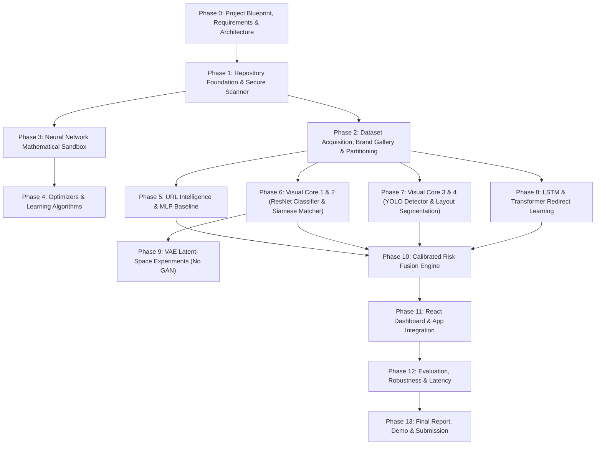

# PHASE_ROADMAP.md — Master 14-Phase Development Roadmap

**Project:** PhishVision AI (Phishing Website and Brand Impersonation Detector)  
**Status:** Approved for Baseline Architecture (Phase 0)  
**Last Updated:** 2026-11-22  

---

## Master Phase Schedule

---

## Detailed Phase Breakdown

### Phase 0: Project Blueprint, Requirements & Architecture
- **Objective:** Establish comprehensive permanent documentation, define system boundaries, data schemas, API contracts, ADRs, and verify hardware/environment configuration before code implementation. Explicitly position Visual Intelligence as the central research contribution with four independent visual modules.
- **Dependencies:** None.
- **Key Deliverables:** `AGENTS.md`, `PROJECT_STATE.md`, `CURRENT_PHASE.md`, `REQUIREMENTS.md`, `ARCHITECTURE.md`, `TECH_STACK.md`, `API_CONTRACTS.md`, `DATASET_MANIFEST.md`, `MODEL_REGISTRY.md`, `DECISIONS.md`, `PHASE_ROADMAP.md`, `.gitignore`.
- **Exit Criteria:** All 10 documentation files populated, verified for internal consistency, and approved. Zero application code or mock implementations created.

---

### Phase 1: Repository Foundation & Secure Playwright Website Scanner
- **Objective:** Establish the production folder structure, configure the Python environment links, and construct an isolated, anti-SSRF, headless Playwright scanner.
- **Dependencies:** Phase 0 completion.
- **Key Deliverables:**
  - Standard repository directory hierarchy (`app/`, `tests/`, `config/`, `data/`, `models/`).
  - `app/scanner/anti_ssrf.py`: Pre-connection DNS resolution and private/reserved IP blocker.
  - `app/scanner/playwright_scanner.py`: Sandboxed browser runner capturing screenshots, sanitized DOM, and redirect logs.
  - Automated unit and integration tests verifying anti-SSRF protection (`tests/test_anti_ssrf.py`) and live safe domain capture.
- **Exit Criteria:** Scanner reliably captures target page screenshots, DOM, and redirects with hard timeout enforcement and proven blocking of `127.0.0.1`, `10.0.0.0/8`, and `169.254.169.254`.

---

### Phase 2: Dataset Acquisition, Brand Gallery, Annotation & Splitting
- **Objective:** Curate verified datasets across all modalities with special emphasis on the Visual Intelligence suite, establish the Curated Brand Reference Gallery (`data/brands/reference_gallery/` for 15–20 brands), enforce deduplication, and execute leakage-safe partitioning.
- **Dependencies:** Phase 1 (scanner available for active validation).
- **Key Deliverables:**
  - Download and audit scripts for candidate sources (Zenodo, PhishTank, OpenPhish, Tranco).
  - Curated Brand Reference Gallery populated with high-res logos (SVG/PNG) and canonical screenshots for 15–20 high-value targets.
  - Deduplication pipeline using pHash and URL canonicalization.
  - Registrable-domain split generator (`data/splits/train_val_test_domain_split.json`).
  - Master dataset manifests (`manifest_screenshots_general.csv`, `manifest_siamese_pairs.csv`, `manifest_brands.json`).
- **Exit Criteria:** Verified dataset containing target counts (~10k screenshots, $\ge 1k$ Siamese pairs, ~1.5k detection annotations), zero domain overlap between train and test splits, and reproducibility script verified with fixed random seed.

---

### Phase 3: Neural Network Mathematical Sandbox
- **Objective:** Build first-principles academic neural network module implementing tensor operations, numerical gradient checking, neurons, and backpropagation from scratch in pure Python/NumPy.
- **Dependencies:** Phase 0.
- **Key Deliverables:**
  - `app/sandbox/tensor_ops.py`: Tensor creation, broadcasting, inner products, SVD.
  - `app/sandbox/neurons.py`: McCulloch-Pitts and Sigmoid neuron implementations.
  - `app/sandbox/mlp_from_scratch.py`: Forward and analytical backprop with numerical gradient check ($\le 10^{-7}$ relative error).
  - Validation test suite executing numerical gradient assertions.
- **Exit Criteria:** All unit tests pass with zero dependency on PyTorch autograd for the scratch implementations.

---

### Phase 4: Optimizers, Ablations & Learning Algorithms
- **Objective:** Implement and benchmark gradient descent optimizers (SGD, Momentum, Nesterov) and distinct biological/energy-based learning paradigms.
- **Dependencies:** Phase 3.
- **Key Deliverables:**
  - Scratch optimizer implementations: GD, Mini-batch SGD, Momentum, Nesterov Accelerated Gradient.
  - Learning algorithm demonstrations: Hebbian, Modified Hebbian (Oja's Rule), Competitive Learning, Error-Correction, and Boltzmann/Energy-based.
  - Comparative ablation report visualizing convergence trajectories and loss surfaces.
- **Exit Criteria:** Unit tests proving weight convergence and stability across all learning paradigms.

---

### Phase 5: URL Intelligence, Homoglyph Detection, Typosquatting & MLP Baseline
- **Objective:** Implement the lexical and domain feature extraction engine, homoglyph detection, typosquatting metric algorithms, and train the baseline MLP classifier.
- **Dependencies:** Phase 2 (URL dataset).
- **Key Deliverables:**
  - `app/intelligence/url_domain/psl_extractor.py`: PSL domain parsing via `tldextract`.
  - `app/intelligence/url_domain/homoglyph.py`: Cross-script Unicode homoglyph detector.
  - `app/intelligence/url_domain/typosquatting.py`: Levenshtein & Damerau-Levenshtein distance against protected brand names.
  - `app/intelligence/url_domain/mlp_baseline.py`: Trained PyTorch MLP URL classifier.
- **Exit Criteria:** Correct classification of test cases (`sbi.co.in`, `sb1.co.in`, `sbi-secure-login-example.com`, `sbi.co.in.attacker.com` identified as `attacker.com`), and MLP baseline achieving F1-score $\ge 0.90$ on test split.

---

### Phase 6: Visual Core 1 & 2: ResNet Screenshot Classifier & Siamese Brand Matcher
- **Objective:** Implement and train the first two core visual modules: Visual Module 1 (ResNet-18/50 layout classifier operating unconditionally on raw screenshots) and Visual Module 2 (Siamese CNN brand similarity engine operating conditionally on detected logos using Triplet Loss).
- **Dependencies:** Phase 2 (screenshot dataset & brand gallery).
- **Key Deliverables:**
  - `app/intelligence/vision/resnet_classifier.py`: Fine-tuned ResNet model for general screenshot layout classification.
  - `app/intelligence/vision/siamese_matcher.py`: Siamese network trained with Triplet Margin Loss on brand reference gallery.
  - Unit tests verifying that ResNet functions without brand references and Siamese outputs neutral signal when no brand is claimed.
- **Exit Criteria:** ResNet achieving ROC-AUC $\ge 0.95$, ECE $\le 0.05$; Siamese matcher achieving Top-1 brand identification accuracy $\ge 0.92$.

---

### Phase 7: Visual Core 3 & 4: YOLO Detector, Faster R-CNN & Layout Segmentation
- **Objective:** Implement and train the spatial visual modules: Visual Module 3 (Ultralytics YOLOv8/v11 for logo and UI input element detection) and Visual Module 4 (U-Net semantic segmentation and YOLO-Seg instance segmentation for layout topology). Include Faster R-CNN comparative benchmark.
- **Dependencies:** Phase 2 (annotated detection and segmentation datasets).
- **Key Deliverables:**
  - `app/intelligence/vision/yolo_detector.py`: Fine-tuned YOLO detection model detecting logos, username/password inputs, and submit buttons.
  - `app/intelligence/vision/faster_rcnn_detector.py`: Two-stage benchmark detector for comparative latency/accuracy evaluation.
  - `app/intelligence/vision/segmentation.py`: U-Net semantic segmenter and YOLO-Seg instance segmenter.
  - Spatial co-occurrence module calculating logo-to-password field proximity.
- **Exit Criteria:** YOLO achieving mAP@50 $\ge 0.85$ with GPU latency $\le 25$ ms; U-Net achieving mIoU $\ge 0.80$; comparative benchmark report completed.

---

### Phase 8: LSTM & Transformer Redirect Sequence Learning
- **Objective:** Train and compare sequence models (LSTM and Transformer) on multi-hop navigation redirect paths and domain transitions.
- **Dependencies:** Phase 2 (redirect dataset).
- **Key Deliverables:**
  - Redirect sequence tokenizer and feature vectorizer.
  - Bi-directional LSTM redirect sequence classifier.
  - Multi-head self-attention Transformer sequence comparator.
  - Sequence classification evaluation report.
- **Exit Criteria:** Both models trained and evaluated; macro F1-score $\ge 0.88$ on holdout redirect sequences.

---

### Phase 9: VAE & Latent-Space Experiments (GAN Excluded)
- **Objective:** Implement a Variational Autoencoder (VAE) to model the continuous latent space of legitimate webpage layouts and generate synthetic hard-negative feature vectors for robustness testing.
- **Dependencies:** Phase 6 (visual embeddings).
- **Key Deliverables:**
  - `app/intelligence/generative/vae_layout.py`: VAE encoder-decoder architecture.
  - Latent space interpolation and reconstruction scripts.
  - Hard-negative perturbation generator and classifier robustness evaluation.
- **Exit Criteria:** VAE successfully trained with stable ELBO convergence; GAN verified completely absent.

---

### Phase 10: Calibrated Risk Fusion Engine
- **Objective:** Build the multi-modal Bayesian / logistic fusion engine synthesizing evidence across all four visual modules (ResNet global score, Siamese brand match, YOLO element co-occurrence, segmentation layout ratios) alongside URL and behavioral telemetry. Apply Platt/Isotonic probability calibration.
- **Dependencies:** Phases 5, 6, 7, 8.
- **Key Deliverables:**
  - `app/fusion/calibrator.py`: Probability calibration module.
  - `app/fusion/risk_engine.py`: Multi-evidence fusion logic with `UNKNOWN / INSUFFICIENT EVIDENCE` fallback.
  - `app/fusion/explainability.py`: Forensic reasoning synthesizer.
- **Exit Criteria:** Fusion engine evaluated across validation and test sets; zero arbitrary heuristic weights; graceful degradation verified under simulated sensor failures.

---

### Phase 11: React Dashboard & Full Application Integration
- **Objective:** Build the complete FastAPI backend microservice and modern React (Vite + Tailwind CSS + Recharts) frontend dashboard with interactive visual overlays.
- **Dependencies:** Phases 1, 5, 6, 7, 8, 10.
- **Key Deliverables:**
  - Complete REST API adhering to `API_CONTRACTS.md`.
  - React single-page application with URL submission bar, progress timeline, interactive screenshot bounding-box viewer, and threat radar charts.
  - End-to-end integration tests connecting frontend to backend.
- **Exit Criteria:** User can submit any URL from the browser UI and receive a full explainable visual report within target latency.

---

### Phase 12: Evaluation, Robustness, Latency & Error Analysis
- **Objective:** Comprehensive testing of system robustness against adversarial attacks (subdomain cloaking, image perturbations, redirect loops), latency profiling, and error breakdown.
- **Dependencies:** Phase 11.
- **Key Deliverables:**
  - Adversarial robustness test suite and error analysis report.
  - Latency profiling across all pipeline components.
  - Confusion matrices, ROC/PR curves, and reliability diagrams.
- **Exit Criteria:** Comprehensive evaluation report documenting strengths, failure boundaries, and verified operational benchmarks.

---

### Phase 13: Final Documentation, Report, Demo & Submission
- **Objective:** Finalize all academic documentation, technical reports, installation manuals, video demonstration script, and prepare code packaging for final submission.
- **Dependencies:** Phase 12.
- **Key Deliverables:**
  - Comprehensive Project Technical Report and Academic Defense Slides.
  - Reproducibility guide and single-command Docker launch configuration.
  - Video demo walkthrough script and presentation assets.
- **Exit Criteria:** All project deliverables finalized, peer-reviewed, and verified against initial requirements.
