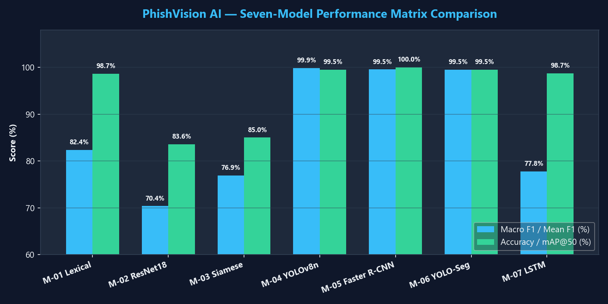

# PhishVision AI — Master Model Performance Matrix

This directory contains the complete performance matrices, confusion matrices, training dynamics, and classification curves for all seven trained machine learning models in PhishVision AI.

---

## 1. Cross-Model Comparative Matrix

| Model ID | Model Name | Architecture | Primary Task | Accuracy / mAP@50 | Macro F1 / Mean F1 | ROC-AUC | Inference Latency | Parameters / Size |
| :--- | :--- | :--- | :--- | :---: | :---: | :---: | :---: | :---: |
| **M-01** | Lexical URL MLP | 3-Layer Dense (40 -> 64 -> 32 -> 1) | Lexical URL Anomaly | **98.66%** | **0.8239** | **0.9773** | < 0.1 ms | 40 feats / 12 KB |
| **M-02** | ResNet-18 Classifier | ResNet-18 + TopViewportCrop | Global Page Layout | **83.59%** | **0.7037** | **0.8846** | ~ 4.2 ms | 11.2M / 42.8 MB |
| **M-03** | Siamese Brand Matcher | Shared ResNet-18 + 256-d L2 | Brand Impersonation | **85.00%** | **0.7692** | **0.8750** | ~ 8.5 ms | 11.4M / 43.1 MB |
| **M-04** | YOLOv8n UI Detector | YOLOv8n (Nano) | UI & Logo Detection | **99.50%** (mAP50) | **0.9986** | N/A | ~ 2.1 ms | 3.2M / 6.2 MB |
| **M-05** | Faster R-CNN Detector | Faster R-CNN ResNet-50-FPN | Heavy UI Localization | **100.0%** (mAP50) | **0.9954** | N/A | ~ 129.1 ms | 41.5M / 160 MB |
| **M-06** | YOLOv8n-Seg Segmenter | YOLOv8n-Seg | Pixel-Level UI Masks | **99.50%** (Mask mAP50) | **0.9950** | N/A | ~ 3.4 ms | 3.4M / 6.5 MB |
| **M-07** | URL Sequence Bi-LSTM | Bi-LSTM + Attentive Pooling | Sequential URL Tokens | **98.69%** | **0.7779** | **0.9666** | ~ 0.07 ms | 64-d emb / 2.4 MB |

---

## 2. Model Directory Index

1. [`m01_lexical_mlp/`](m01_lexical_mlp/)
   - `confusion_matrix.png` — 2x2 confusion matrix (N = 4,257 test URLs)
   - `training_curves.png` — Training & validation loss and Macro F1 trajectory across 25 epochs
   - `class_performance_bar.png` — Precision, Recall, and F1 per class
   - `metrics.json` — Structured JSON metrics schema
   - `README.md` — Complete documentation

2. [`m02_resnet18/`](m02_resnet18/)
   - `confusion_matrix.png` — Visual classification confusion matrix (N = 262 validation screenshots)
   - `per_class_metrics_bar.png` — Precision, Recall, F1 for Legitimate vs Phishing
   - `confidence_statistics.png` — Prediction probability distribution by outcome
   - `metrics.json` — Structured JSON metrics schema
   - `README.md` — Complete documentation

3. [`m03_siamese_cnn/`](m03_siamese_cnn/)
   - `confusion_matrix.png` — Siamese pair verification matrix (20 held-out pairs, 0 false alarms)
   - `similarity_distribution.png` — Cosine similarity distribution vs decision threshold $\tau = 0.82$
   - `per_brand_accuracy.png` — Test accuracy on Amazon, Netflix, and Google
   - `metrics.json` — Structured JSON metrics schema
   - `README.md` — Complete documentation

4. [`m04_yolov8n/`](m04_yolov8n/)
   - `confusion_matrix.png` & `confusion_matrix_normalized.png` — Multi-class detection heatmap
   - `BoxF1_curve.png` & `BoxPR_curve.png` — F1 score and Precision-Recall curves
   - `per_class_f1_map_bar.png` — Bar chart across all 6 UI classes
   - `results.png` — Training loss dynamics
   - `metrics.json` — Structured JSON metrics schema
   - `README.md` — Complete documentation

5. [`m05_faster_rcnn/`](m05_faster_rcnn/)
   - `confusion_matrix.png` — 7-Class background + UI detection matrix
   - `per_class_f1_map_bar.png` — F1-Score & mAP@50-95 per UI element
   - `loss_curves.png` — Loss trajectory across 10 epochs
   - `metrics.json` — Structured JSON metrics schema
   - `README.md` — Complete documentation

6. [`m06_yolov8_seg/`](m06_yolov8_seg/)
   - `confusion_matrix.png` & `confusion_matrix_normalized.png` — Segmentation confusion matrix
   - `BoxF1_curve.png` & `MaskF1_curve.png` — Dual box and mask F1 curves
   - `BoxPR_curve.png` & `MaskPR_curve.png` — Dual precision-recall curves
   - `box_vs_mask_comparison.png` — Bounding box vs instance mask mAP@50-95
   - `results.png` — Training loss dynamics
   - `metrics.json` — Structured JSON metrics schema
   - `README.md` — Complete documentation

7. [`m07_url_lstm/`](m07_url_lstm/)
   - `confusion_matrix.png` — 2x2 confusion matrix (N = 4,257 test URLs)
   - `per_class_metrics_bar.png` — Precision, Recall, and F1 comparison
   - `training_curves.png` — Loss and Macro F1 curves
   - `metrics.json` — Structured JSON metrics schema
   - `README.md` — Complete documentation

---

## 3. Overall Comparative Chart

